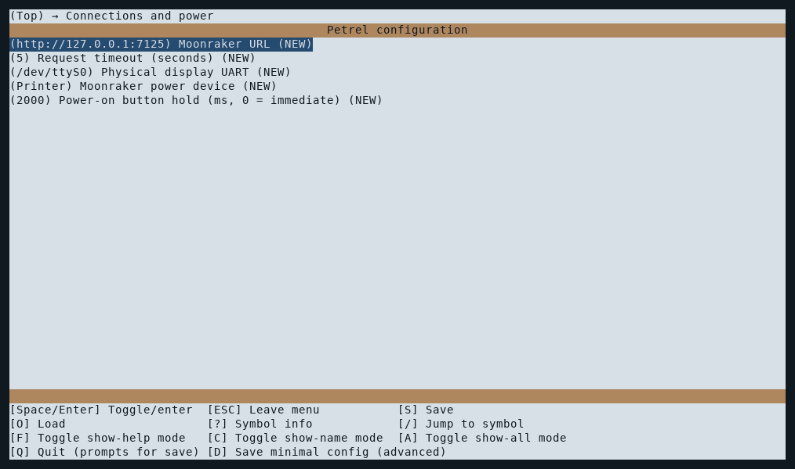
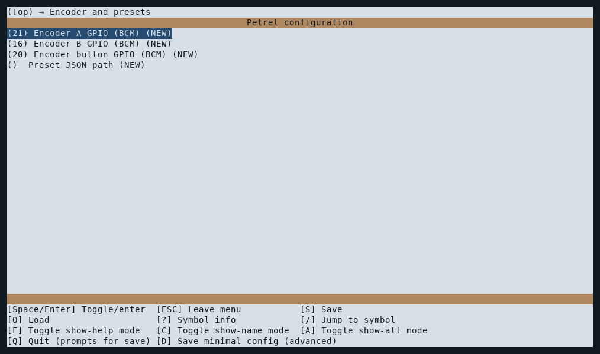
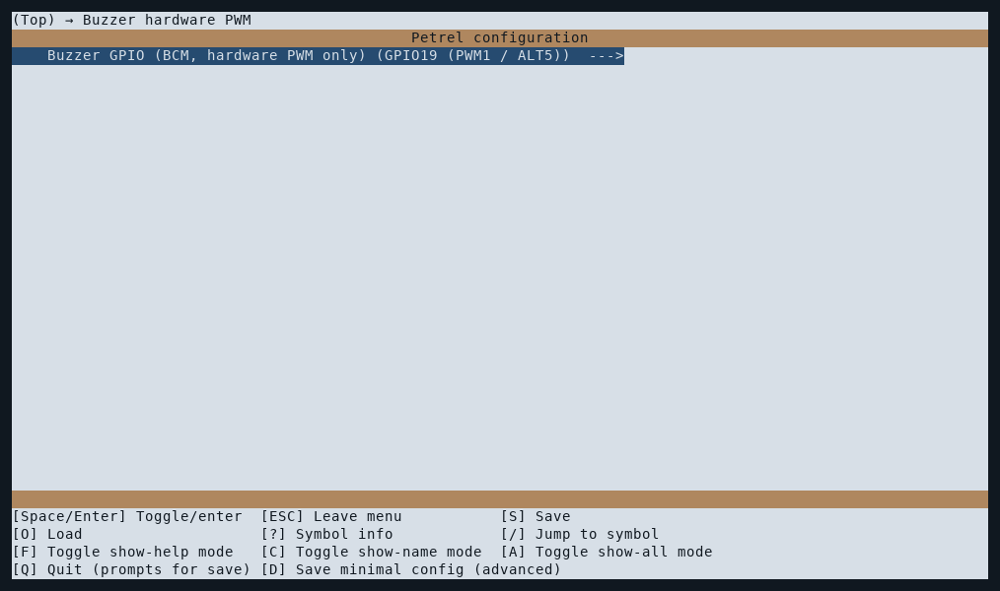
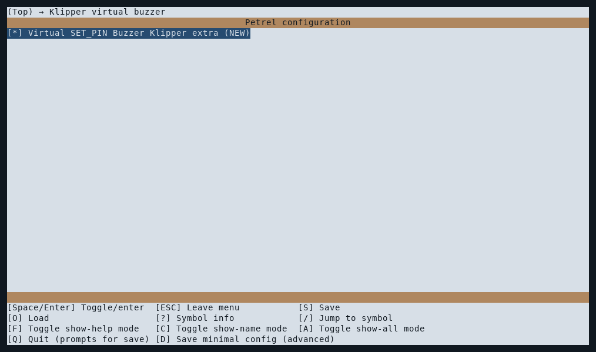
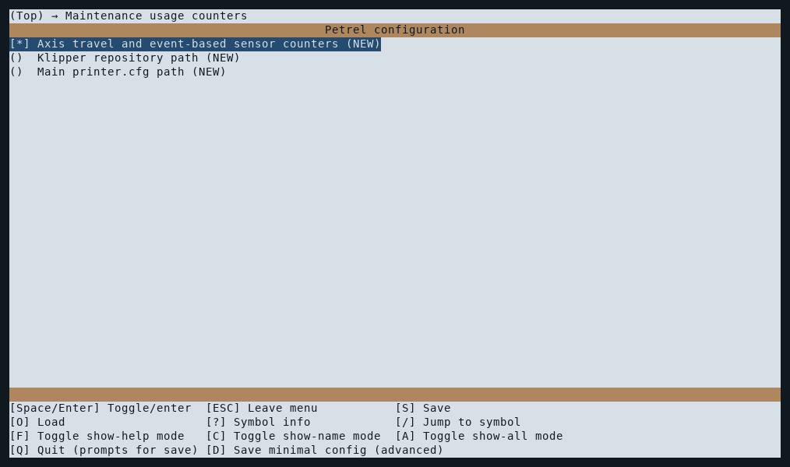
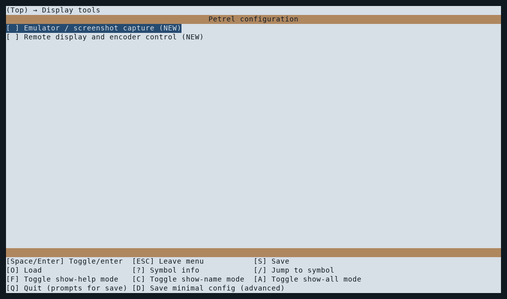
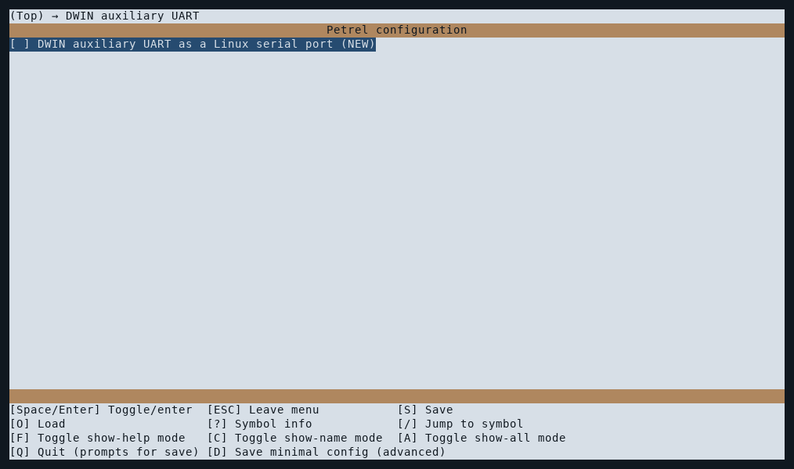
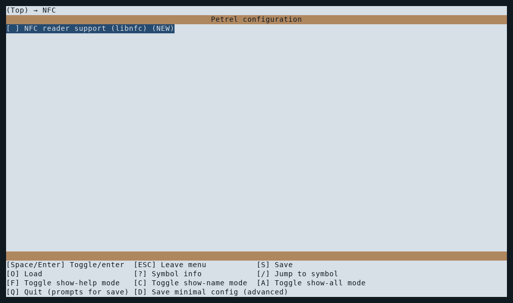
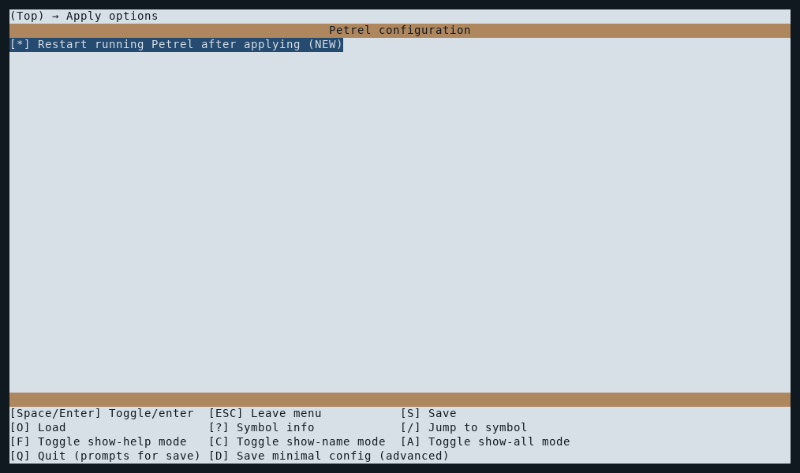

# Kconfig yapılandırma menüsü

[Dokümantasyon](README_TR.md) · [English](configuration.md)

Terminal menüsünü açmak için `~/Petrel` içinde `./configure.sh` çalıştırın.
`install.sh`, ilk kurulumda aynı menüyü kullanır. Kconfiglib 14.1.0 yalnız yapılandırma
bağımlılığıdır; eksikse betik mevcut Petrel sanal ortamına kurar. Bu ortam yoksa ayrı
ve özel bir yapılandırma sanal ortamı oluşturur. Yapılandırıcı çalışan arayüze arka
plan işi eklemez.


Görseller güncel Kconfig terminal arayüzünü temiz ilk-kurulum Kconfig varsayılanlarıyla gösterir; özel makine ortamı içeri alınmaz. Boş yollar kendi kurulumunuz için seçilmelidir. Mevcut kurulumlar kayıtlı değerlerini alır; encoder ve diğer ayarlar farklı olabilir, Apply eski kablolamayı sessizce değiştirmez. Menü etiketleri iki dilde de İngilizcedir.

## Gezinme ve uygulama

Oklar ve Enter ile gezinin/düzenleyin, Space ile seçenek değiştirin, `?` ile yardımı
açın, `S` ile kaydedin, `Q` ile çıkın. Bağlantı/güç, enkoder/preset, bakım sayaçları,
donanımsal PWM buzzer, Klipper virtual buzzer, ekran araçları, DWIN yardımcı UART, NFC ve uygulama seçenekleri menüleri bulunur.
Kapalı özelliğe bağlı ayarlar gizlenir; tekrar açıldıklarında kayıtlı değerleri korunur.

Mevcut ayarlar `~/.config/Petrel/Petrel.env` dosyasından alınır. Menuconfig içinde
kaydetmek yalnız seçimi hazırlar. Menüden çıkınca **Apply saved configuration**
sorusuna `y` yanıtı vermek kurulumu/kaldırmayı uygular ve ortam dosyasını atomik olarak
kaydeder. Kaydetmeden çıkmak veya Apply sorusuna `n` demek çalışma ayarlarını ve
isteğe bağlı kurulumları değiştirmez. İlk kurulum iptal edilirse servis kaydından önce
installer durur. Bağımlılık hazırlığı o aşamada tamamlanmış olabilir.

**Restart running Petrel after applying** varsayılan açıktır. Son yeniden başlatmayı
atlamak için kapatın; ortak UART bağlantısını değiştirmek, bileşen installer'ının
içinde yine restart gerektirebilir. Klipper otomatik yeniden başlatılmaz. Sayaç
extra'sını değiştirdikten sonra Klipper'ı boşta iken elle yeniden başlatın.

## Menülere göre ayarlar

### Connections and power

Moonraker adresini, istek zaman aşımını, fiziksel ekran UART'ını ve güç kontrollerini
ayarlayın. **Physical display UART**, host üzerinde ekrana bağlı porttur; buraya
`/dev/ttyDWIN0` veya takma adını girmeyin.



### Encoder and presets

Enkoder A/B ve düğme GPIO'larını BCM numaralandırmasıyla, harici preset JSON dosyasının
yolunu ise kendi kurulumunuza göre ayarlayın. Gerçek kablolamanızdaki pinleri kullanın.



### Buzzer hardware PWM

Buzzer pinini yalnızca GPIO12 (PWM0), 13 (PWM1), 18 (PWM0) veya 19 (PWM1) arasından seçin; varsayılan GPIO19. Enkoder A/B veya butonla çakışamaz. Fiziksel pini ve boot overlay'ini Kconfig ayarlar; LCD'de yalnız Enabled/Disabled, volume ve tonlar değişir. Boot overlay'i değişmişse reboot gereklidir. Klipper output pin kullanılmaz.



### Klipper virtual buzzer

**Virtual SET_PIN Buzzer Klipper extra** seçeneği varsayılan **açık** gelir. Apply sonrasında gerçek Klipper GPIO'su kullanmadan `[petrel_buzzer Buzzer]` extra'sını kurar. Eski `SET_PIN PIN=Buzzer VALUE=... CYCLE_TIME=...` makroları değişmeden çalışır; Jinja uyumluluğu eklenmez. Klipper restart öncesi eski `[pwm_cycle_time Buzzer]` bölümünü kendiniz silin. Seçenek kapatılırsa yalnız Petrel yönetimli Klipper modülü/config kaldırılır, LCD buzzer etkilenmez.



### Maintenance usage counters

İsteğe bağlı Klipper extra'sını açın veya kaldırın; mevcut Klipper deposunu ve ana
yazıcı yapılandırmasını seçin. Extra değişikliğinden sonra Klipper'ı boşta iken elle
yeniden başlatın. Ayrıntılar [kurulum rehberindedir](installation_TR.md#isteğe-bağlı-eksen-mesafesi-sayaçları).



### Display tools

Ekran görüntüsü yakalamayı ve uzaktan ekran/enkoder kontrolünü açın veya kapatın.
Remote display açıldığında dinleme adresi ve port ayarları görünür. Ayrıntılar
[emülatör rehberindedir](ui-emulator_TR.md).



### DWIN auxiliary UART

Linux seri portunun kurulumunu açın veya kapatın. Aşağıdaki varsayılan örnek işaretsizdir.
Kurulumu seçmek için işaretleyin; kaydedin, çıkın ve Apply sorusunu onaylayın. İşareti kaldırıp
uygulamak portu kaldırır. Donanım konumu, kullanım ve sınırlar için
[UART rehberine](dwin-uart_TR.md) bakın.



## Koruma ve hatalar

Özel anahtarlar ve gizli `MOONRAKER_API_KEY` kayıtları ortam dosyasında korunur;
API anahtarı menüde gösterilmez ve Kconfig dosyasına aktarılmaz. Preset yolu ve özel
remote adresi/portu içeri alınır. Ortam dosyası `0600` izniyle korunur; Git çalışma
dizinine `.config` veya kuruluma özel dosya eklenmez.

Uygulama adımı installer'ları çağırmadan önce bütün alanları doğrular. Menü açıkken
başka süreç ortam dosyasını değiştirmişse üzerine yazmak yerine menüyü yeniden açın.
Installer hataları ortam dosyasını değiştirmez ve önceki başarılı bileşen değişiklikleri
geri alınmaya çalışılır; geri alma hatası açıkça bildirilir. İsteğe bağlı bileşenlerin
kendi kurulum kontrolleri korunur; kullanımda yardımcı UART'ın kaldırılmasını
reddetme de buna dahildir.

## Açıkça seçilen otomatik yapılandırma

Eski soru dizisine boru üzerinden yanıt gönderme desteklenmez. Hiçbir şey uygulamadan
mevcut ayarları dışarı aktarın:

```bash
./configure.sh --export-config ~/petrel-settings.config
```

Özel izinli bu dosyayı Kconfig biçimiyle düzenleyin (`CONFIG_PETREL_AUX_UART=y`,
`CONFIG_PETREL_NFC=y`, `CONFIG_PETREL_AXIS_TRAVEL=n`, tırnaklı metinler), ardından açıkça uygulayın.
`PETREL_NFC`, yalnız libnfc çalışma zamanı paketini kurup kaldırır. Okuyucu UART'ı
çalışma zamanında seçilir; DWIN yardımcı UART'ını etkinleştirmez veya zorunlu kılmaz.
Örneğin:

```bash
./configure.sh --apply-config ~/petrel-settings.config --no-restart
```

Verilen dosya kısmi olabilir: bulunmayan semboller içeri alınan değerlerini korur.
Geçersiz/bilinmeyen ayarlar uygulama öncesinde reddedilir. `--no-restart`, bileşen
installer'ının gerektirdiği bağlantı değişimini değil, yalnız son Petrel restart'ını
atlar. API anahtarı ve menüde yer almayan diğer ayarlar hedef makineden korunur.

## NFC

**NFC reader support (libnfc)** çalışma bağımlılığını kurar; varsayılan kapalıdır. Okuyucuyu veya kablolamasını seçmez, DWIN yardımcı UART gerektirmez. Model, arayüz, port ve Test connection ayrıca **Home → Device → NFC Settings** üzerinden ayarlanır. [NFC kullanımı](user-guide_TR.md#nfc-ve-rfid) ve [LCD örnekleri](screenshots_TR.md#nfc-kartları-ve-makara-atama) çalışma akışını anlatır. Kurulum seçeneği kapatıldığında okuyucu tercihleri korunarak yönetilen bağımlılık kaldırılır.



## Yapılandırma görsellerini yeniden üretme

`python tools/render_configuration_screenshots.py`, gerçek menuconfig curses çıktısını izole Linux PTY içinde yakalar. Kconfiglib 14.1.0, pyte 0.8.2, Pillow ve DejaVu Sans Mono sistem fontu gerekir. Kurulu ortam dosyası okunmaz, yapılandırma kaydedilmez/uygulanmaz; on görsel de hazırlanmadan yayımlanmış dosyalar değiştirilmez. LCD emülatöründen ayrı bir araçtır. CI tam doküman yayınında çalıştırır.


