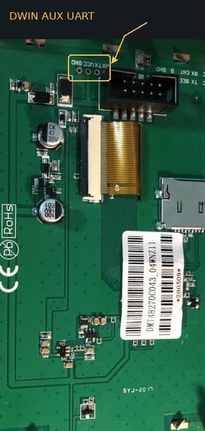

# İsteğe bağlı DWIN yardımcı UART

[Dokümantasyon](README_TR.md) · [English](dwin-uart.md)

Yardımcı port Linux TTY aygıtı olarak sunulabilir. İsteğe bağlıdır ve **varsayılan kapalıdır**.
Özellik `feature/dwin-aux-uart` dalında geliştirilmektedir: CI, gerçek TTY arayüzünü
Linux 6.1 ve 6.12 sanal makinelerinde sınar; fiziksel DWIN/Pi kabulü beklemektedir.

## Yardımcı portun yeri



Sarı çerçeve ve ok, fotoğraftaki kartın siyah ekran konnektörü yanındaki yardımcı
UART bağlantısını gösterir. Bağlantıda VCC, RX, TX ve GND bulunur; konnektör gövdesi
fotoğrafta bağlantının bir kısmını örter. İşaretleme pin sırasını değil bağlantı
bölgesini gösterir; kendi kartınızdaki baskı yazılarını esas alın.

## Etkinleştirme veya kaldırma

`~/Petrel` içinde `./configure.sh` çalıştırın. **DWIN auxiliary UART** menüsündeki
**DWIN auxiliary UART as a Linux serial port** seçeneğini Space ile değiştirin;
kaydedip çıkın ve Apply sorusunu onaylayın. İşaretli seçenek portu kurar, işareti
kaldırmak portu kaldırır. İlk `./install.sh` kurulumu da
bu seçimi içerir. Mevcut ayarlar korunur; aynı yapılandırmayla tekrar etkinleştirme,
çalışan portu kesmez. Kaldırmadan veya kurulumu değiştirmeden önce yardımcı portu
kullanan programları kapatın. Kaldırma, Petrel'in doğrudan ekran bağlantısını geri getirir.

Kurulum, **çalışan** kernelin başlıklarını edinir, DKMS modülünü derler, udev izinlerini
kurar ve `Petrel-dwin.service` servisini etkinleştirir. Device Tree değiştirilmez ve
başka kernel kurulmaz. Eksik başlık/derleme hatası, ekran bağlantısı değiştirilmeden
isteğe bağlı kurulumu durdurur. Sonraki aşamalardaki hatalarda önceki bağlantıya dönüş
denenir. Ortak derleme bağımlılıkları kaldırmada korunur. DKMS, uygun başlıklar mevcutsa
sonraki kerneller için modülü yeniden derler. Secure Boot sistemlerinde mevcut modül
imzalama/anahtar kaydetme sürecinin uygulanması gerekebilir.


Etkinleştirildiğinde mevcut Moonraker Petrel güncelleme kaydı ortak servisi de yönetir.
Güncellemeden önce yardımcı port istemcilerini kapatın; ortak servisin yeniden başlaması
hangup üretir. Kernel modülü kaynak değişikliklerini uygulamak için `configure.sh`
yeniden çalıştırılmalıdır; DKMS kernel sürüm değişikliklerini yönetir, Git çalışma
dizinindeki her kaynak değişikliğini kendiliğinden yüklemez.

## Başka programdan kullanma

Port `/dev/ttyDWIN0` yolundadır. `/dev/ttyS_DWIN0` listeleme takma adı, Linux tarayıcısında
sabit ad kalıpları kullanan pySerial 3.5 gibi araçlar için aynı aygıtı gösterir.
Uygulamalar Petrel API'sine ihtiyaç duymaz. Otomatik listeleme, uygulamanın tarayıcısına
bağlıdır; her iki yol da elle girilebilir. Erişim, ekranın fiziksel UART'ında olduğu
gibi standart `dialout` grubu üzerinden sağlanır.

Moonraker/Mainsail portu **HARDWARE UART**, sürücüyü **petrel_uart** olarak listeler.
Uç nokta `dwin` bus'ında sürücüye bağlanır; salt okunur TTY sysfs alanları
`uartclk=15667200` (panelin baud üreteci saati) ve `port=0x0` (host I/O adresi yok)
bilgilerini sunar. Bu sınıflandırma doğrudan host MMIO UART anlamına gelmez ve
aşağıdaki ortak bağlantı sınırlarını değiştirmez. Mevcut kurulumda güncelleme için
`./configure.sh` yeniden çalıştırılıp yardımcı UART etkin halde uygulanmalıdır;
modül yeniden derlenip yüklenir. Ardından Mainsail cihaz listesini yenileyin.

```python
import serial

with serial.Serial('/dev/ttyDWIN0', baudrate=115200, timeout=1) as port:
    port.write(b'hello\r\n')
    reply = port.read(64)
```

Standart `open`, `read`, `write`, `poll` ve `termios` desteklenir. Baud ayarı yalnızca
**yardımcı** UART'a uygulanır. Ana ekran bağlantısı 115200 baud kalır. Ortak servis
bağımsız çalışır: `Petrel.service` durdurulsa da yardımcı port kullanılabilir;
ortak servisin durması veya ekran bağlantısının kaybı açık istemcilere hangup bildirir.
Bağlantı düzeldikten sonra kopan port yeniden açılmalıdır.

## Sınırlar

- 8 veri biti, parity yok, 1 stop biti. Modem kontrolü ve donanımsal akış kontrolü yoktur.
- Varsayılan 115200 baud. Belgelenen bölücü aralığı `1..1023` ve hesap
  `divisor = round(15667200 / baud)` şeklindedir. **15300 baud** altı istekler,
  9600 dahil desteklenmez. Gerçek hız bölücü yuvarlamasına bağlıdır. Desteklenmeyen
  donanım ayarlarında önceki termios donanım yapılandırması korunur; belirli bir
  hıza ihtiyaç duyan uygulama ayarı geri okumalıdır.
- Ekran ve yardımcı port, tek 115200-baud fiziksel bağlantıyı paylaşır. Yardımcı
  UART'ın baud değeri, uçtan uca aktarım hızı garantisi değildir. Paket ek yükü,
  ekran çizimi, kernel zamanlaması ve panel gecikmeyi etkiler.
- Servis, gönderimi en çok 248 baytlık komutlara böler, veri içindeki DWIN
  sonlandırıcısıyla çakışmayı önler ve tam ekran/yardımcı paketlerini dönüşümlü
  gönderir. Tamponlar sınırlıdır; gönderimde geri basınç uygulanır, alım taşmasında
  hata kaydedilip hangup üretilir. Aşırı yükte kaynak tarafındaki kaybı önleyecek
  donanımsal akış kontrolü bulunmaz.
- DWIN fiziksel gönderim tamamlandı yanıtı vermez. `tcdrain`, temkinli bir aktarım
  süresi hesabı kullanır; yardımcı portun son stop bitinin fiziksel ölçümü değildir.

## Tanılama ve fiziksel kabul

Servis hataları için `journalctl -u Petrel-dwin.service`, servis durumu için
`systemctl status Petrel.service Petrel-dwin.service` kullanın.
Ekran kapalıyken aygıt düğümü bulunabilir; portun açılması için ortak servis
bağlantısı ve başarılı panel handshake gerekir.

Sürüm öncesinde gerçek panel/Pi üzerinde doğrulanacaklar: kurulum/kaldırma/tekrar kurulum;
`CC 33 C3 3C` dahil ikili verilerle yardımcı TX/RX loopback; logic analyzer ile
19200/115200 baud; pySerial/minicom erişimi ve listeleme; eşzamanlı ekran gezinmesi;
yalnız Petrel'in yeniden başlatılması; panel enerji kesintisi ve toparlanma; kullanımda
portun kaldırılmasının engellenmesi; sürekli trafikte CPU/RAM/gecikme. Kernel sanal
makine testleri bu kontrollerin yerine geçmez.
