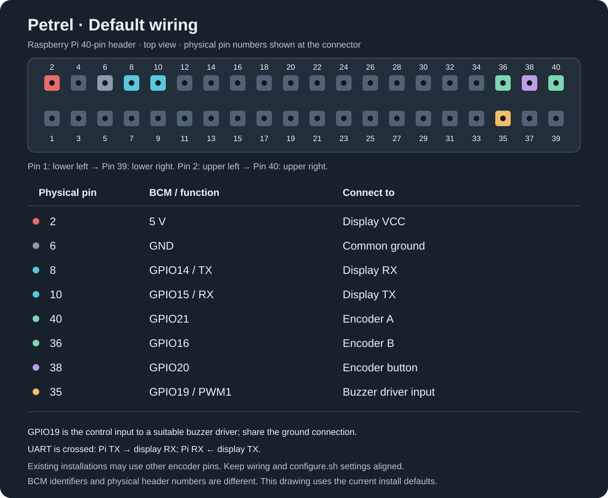
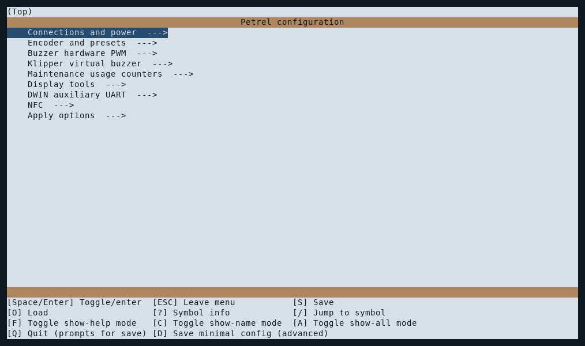

# Installation and configuration

[English](installation.md) · [Türkçe](installation_TR.md) · [Documentation](README.md)

## Before installation

> **⚠️ Persistent LCD resource overwrite:** On first connection or when resources change, Petrel automatically writes its own boot JPEG, shared slot-1 JPEG page and icon library to the DWIN LCD's non-volatile Picture Flash. These replace stock visual data and remain after shutdown or Pi software removal. This is required for Petrel's current interface symbols, animations and efficient native rendering. The [original Creality DWIN_SET](../assets/stock-dwin/DWIN_SET) and a [step-by-step stock restoration guide](restore-stock-dwin.md) are included. **Review this before installing or updating.**

Use a compatible DWIN T5UIC1 panel, a Linux SBC with UART/GPIO, Python 3.11+ and a working Klipper/Moonraker setup. Check [LCD compatibility](lcd-assets.md). The installer does not flash LCD kernel firmware or fonts; the application synchronizes Petrel icons automatically at its first LCD connection.

## Wiring and serial setup

| Display connection | Raspberry Pi connection |
|---|---|
| RX | GPIO14 / UART TX |
| TX | GPIO15 / UART RX |
| Encoder A | GPIO21 |
| Encoder B | GPIO16 |
| Encoder button | GPIO20 |
| Hardware PWM buzzer | GPIO19 / physical pin 35 (via suitable driver) |
| VCC | 5 V |
| GND | GND |

GPIO numbers are **BCM numbers**. The following diagram shows the current installer defaults and their physical header positions. Encoder pins can be changed during configuration; preserve your existing wiring when updating.



The old [wiring photos and GPIO drawing](../images/README.md) are historical installation examples with different pin assignments; use the diagram above for new default wiring.

In `sudo raspi-config`, enable serial hardware and disable the serial login console, then reboot. Confirm which UART device uses GPIO14/15 on your Pi and OS. The installer suggests `/dev/ttyS0`; choose the device appropriate for your installation.

## Install

Run as the user who will own the service. The checkout must be clean and located at `~/Petrel`:

```bash
cd ~
git clone https://github.com/sezgynus/Petrel.git
cd ~/Petrel
./install.sh
```

The first installation opens the Kconfig menu. Review these defaults, then save, exit and confirm Apply:



| Setting | Installer default |
|---|---|
| Moonraker URL | `http://127.0.0.1:7125` |
| UART | `/dev/ttyS0` |
| Encoder A/B | `21 16` |
| Encoder button | `20` |
| Moonraker power device | `Printer` |
| Power-on hold | `2000` ms (2 seconds) |
| Axis travel counters | Enabled; toggle off with Space to decline |
| Klipper repository (when enabled) | `~/klipper` |
| Main Klipper config (when enabled) | `~/printer_data/config/printer.cfg` |
| Emulator / screenshot capture | `0` disabled |
| Remote display | `0` disabled |

Installation prepares `~/petrel-env`, installs dependencies and enables `Petrel.service`. It keeps settings in `~/.config/Petrel/Petrel.env`, adds a `Petrel.conf` include beside `moonraker.conf` and registers the service for Moonraker updates. Existing settings are preserved when installation is repeated.

For a nonstandard Moonraker configuration location:

```bash
MOONRAKER_CONFIG=/path/to/moonraker.conf ./install.sh
```

## Optional axis travel counters

The Kconfig menu provides **Maintenance usage counters → Axis travel and event-based sensor counters**. It defaults to enabled at first configuration; toggle it with Space. Later runs preserve your saved choice. Existing installations are not silently modified on update: run `./configure.sh` to select this feature.

Enabling creates `klippy/extras/petrel_axis_travel.py` as a symlink to the extra in the Petrel repository, creates `petrel-axis-travel.cfg` beside your main Klipper config, and inserts a marked include block at the beginning of that main config, unless an existing wildcard include already covers the fragment. It does not change tracked Klipper source or `.gitignore`: only that exact symlink path is added to the repository-local Git exclude file. Existing user exclusions are retained. Foreign conflicting files are not overwritten. Connection, encoder, power and optional integration settings are editable in the corresponding Kconfig menus.

**Restart Klipper while idle after enabling or disabling**, then restart Petrel to refresh discovery. The configurator never restarts Klipper automatically. Petrel offers X/Y/Z travel devices and **Recorded travel (metres)** reminders only when the extra is actually loaded. See [usage tracking](maintenance-usage.md) for measurement limits and resource bounds.

Run `./configure.sh` again, uncheck the counters option, save and apply to disable. This removes only Petrel's managed config fragment/include, symlink and its own added Git exclusion. Counters and maintenance history remain; saved distance reminders pause. Apply the same idle Klipper restart. The extra follows Petrel updates through the symlink; running Klipper loads the updated module on its next restart. A Klipper reinstall/hard recovery may remove the link: rerun `configure.sh` to repair it.

## Hardware PWM buzzer

The Kconfig **Buzzer hardware PWM** menu selects one of GPIO12/13/18/19, default GPIO19 (encoder B defaults to GPIO16). The installer writes a compatible device-tree PWM overlay or reuses an existing compatible one, disables the conflicting analogue PWM audio and installs a privileged systemd pre-start helper granting the unprivileged UI process access to its PWM channel. Reboot the Pi if the boot overlay changes; Klipper need not restart.

Legacy installations with encoder B on GPIO19 are preserved: automatic PWM provisioning is skipped until `./configure.sh` selects nonconflicting GPIOs. A legacy pin conflict silences the buzzer rather than preventing the UI from starting. Use a transistor buzzer driver if the buzzer current exceeds Pi GPIO limits.

## Optional Klipper virtual buzzer

`./configure.sh` now defaults **Virtual SET_PIN Buzzer Klipper extra** to enabled. It installs `[petrel_buzzer Buzzer]` in a managed include and registers the matching Klipper module without changing G-code macros. **Remove the old `[pwm_cycle_time Buzzer]` section manually before restarting Klipper**, otherwise `SET_PIN PIN=Buzzer` would have two owners. Klipper is never automatically restarted by the configurator; restart it while idle.

The Klipper extra communicates with Petrel via a private local socket at `~/.config/Petrel/klipper-buzzer.sock`, not a physical Klipper pin. When Klipper and Petrel run under different OS accounts, arrange private socket access before using the feature. See [user guide](user-guide.md#klipper-virtual-buzzer-optional-extra) for `VALUE`, `CYCLE_TIME` and sound priorities.

## LCD resources and first start

**LCD font installation is optional.** Petrel works with the stock DWIN font. For the typography shown in Petrel's screenshots, you may optionally [install the bundled LCD font](lcd-assets.md#lcd-font) from the display's SD slot. Icons and boot artwork synchronize automatically over UART.

1. Wait for Petrel startup progress to finish and **Home** to appear.
2. Rotate the encoder and open a menu; check temperatures against the web interface.
3. For wrong text/icons, follow the [LCD resource guide](lcd-assets.md); for connection failures, use the troubleshooting table below.

Normal cold-start MCU connection delays keep the splash for up to 30 seconds; explicit errors/shutdowns open recovery immediately. See [connection and recovery](user-guide.md#printer-connection-and-recovery) for refresh/restart actions.

Moonraker must authorize the Petrel connection. Set `MOONRAKER_API_KEY` if authentication is required. Check the service user's serial/GPIO permissions; the installer configures the `dialout` and `gpio` groups.

## Change settings

```bash
cd ~/Petrel
./configure.sh
```

`configure.sh` opens a Kconfig terminal menu. Existing values are imported from `Petrel.env`;
new emulator, remote display and auxiliary UART options default to off. Use arrows/Enter
to navigate, Space to toggle, `?` for help, `S` to save and `Q` to exit. After saving,
confirm **Apply saved configuration** to install/remove selected components and write
settings. Exit without saving, or decline Apply, to keep the current installation.
The **Apply options** menu controls the final restart of a running Petrel; Klipper is
never restarted automatically. See the [configuration guide](configuration.md) for
unattended setup, preservation and failure handling. Brightness/dimming remain on
the LCD under **Home → Device**.

For settings not listed in the menu, edit the external environment file. Use plain `KEY=value` lines, without `export`:

| Setting | Purpose / default |
|---|---|
| `MOONRAKER_URL` | Moonraker address / `http://127.0.0.1:7125` |
| `MOONRAKER_API_KEY` | Authentication key if required / empty |
| `PETREL_REQUEST_TIMEOUT` | Request timeout in seconds / `5` |
| `PETREL_SERIAL_PORT` | Configured UART / installer suggests `/dev/ttyS0` |
| `PETREL_ENCODER_PINS` | Encoder A/B in BCM numbering / `21 16` |
| `PETREL_BUTTON_PIN` | Encoder button in BCM numbering / `20` |
| `PETREL_BUZZER_GPIO` | Native Pi PWM buzzer GPIO12/13/18/19, default `19` |
| `PETREL_SETTINGS_FILE` | Local preset fallback / `~/.config/Petrel/presets.json` |
| `PETREL_POWER_DEVICE` | Name of your Moonraker power device / `Printer` |
| `PETREL_POWER_ON_HOLD_MS` | Power-on hold in milliseconds / `2000`; `0` means immediate |
| `PETREL_EMULATOR` | Screenshot capture / `0` disabled, `1` enabled; selectable in the Kconfig menu |
| `PETREL_REMOTE` | Browser display and encoder control / `0` disabled, `1` enabled; also starts emulator |
| `PETREL_REMOTE_HOST` | Remote listener / `0.0.0.0`; preserved by configurator |
| `PETREL_REMOTE_PORT` | Remote port / `8088`; preserved by configurator |
| `PETREL_NFC` | Optional libnfc runtime dependency / `0` disabled; enable or remove through `configure.sh`; independent of DWIN auxiliary UART |
| `PETREL_AXIS_TRAVEL` | Optional extra installation preference / `1` on first configuration; change using `configure.sh`, not by editing this key alone |
| `PETREL_KLIPPER_DIR` | Klipper repository containing `klippy/extras` / `~/klipper` |
| `PETREL_PRINTER_CONFIG` | Main config to receive the managed include / `~/printer_data/config/printer.cfg` |

Restart after editing: `sudo systemctl restart Petrel.service`. Keep private keys and machine settings outside tracked repository files. See the [emulator guide](ui-emulator.md) for screenshot-specific options.

## Update

### Updates and migration from older installations

Existing installations migrate automatically after their next Moonraker update: the old updater downloads this version, and the first service start schedules a separate migration job. It preserves settings, moves the checkout to `~/Petrel`, prepares `~/petrel-env`, installs `Petrel.service` and reloads Moonraker with the new updater. Allow a few minutes for Python dependencies. Automatic migration requires the same passwordless sudo access normally available on the Pi; otherwise run `sudo python3 ~/KlipperDWIN/petrel_migration.py --user "$USER"` once. Migration refuses to overwrite an existing Petrel installation. A failed service switch restores the previous installation; details are in `journalctl -u Petrel-migration.service`.

After Moonraker reloads its configuration, use **Mainsail → Machine → Update Manager → Petrel**. Refresh and update; dependencies and the service restart are handled automatically. Update Manager follows `master`.

You can also check and install Petrel updates from **Info** on the LCD while the printer is idle. See [Info and updates](user-guide.md#info-and-updates). Local edits to tracked repository files may block updating; inspect or back them up before recovery discards them.

## Troubleshooting

```bash
sudo systemctl status Petrel.service --no-pager
journalctl -u Petrel.service --since "10 minutes ago" --no-pager
sudo systemctl restart Petrel.service
```

| Symptom | What to check |
|---|---|
| Blank screen or repeated reconnects | Panel power, crossed TX/RX, selected UART, serial login console and permissions |
| Encoder does not respond | BCM pin settings and wiring |
| Startup stays on one stage | Klipper/Moonraker readiness, panel resources and service logs |
| Optional menu missing or locked | Required Klipper/Happy Hare configuration, connection and current printer state |
| Preview image or metadata missing | Slicer thumbnails and metadata available in Moonraker |
| Wi-Fi information unavailable | Wireless connection and availability of Linux `iw` |
| Update blocked | Local repository edits and Moonraker Update Manager status |
| Action failed or timed out | Check the actual printer state in Mainsail before repeating |

For a bug report, include the software revision, Pi/OS, configuration relevant to the problem and the log excerpt. Add a photo or [emulator screenshot](ui-emulator.md) for visual problems; remove credentials before sharing.

### Sensor event counters in an extra update

The existing optional axis-travel extra now also supplies event-based sensor counters. The shared `configure.sh` option preserves its existing `PETREL_AXIS_TRAVEL` key. No additional extra file/include is needed. An installed symlink follows the updated file; restart Klipper while idle to load it, then restart Petrel. Klipper is not restarted automatically. An old/disabled/missing extra pauses event-based reminders and preserves histories. See the [usage counter guide](maintenance-usage.md#event-based-sensor-counters) for supported sources and counting coverage.

## Optional auxiliary UART

Run `./configure.sh` to install or remove the optional Linux serial port provided
by the DWIN auxiliary UART. It is off by default. See [setup and limits](dwin-uart.md).
