# Daily use

[English](user-guide.md) · [Türkçe](user-guide_TR.md) · [Documentation](README.md)

## Navigation and dashboard

<p align="center">
  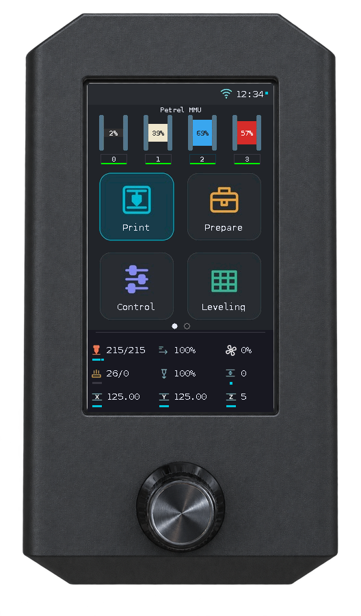
  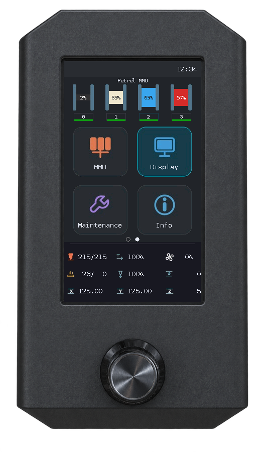
</p>

Rotate to move the highlight; press to select. Press a numeric value, rotate to edit it and press again to apply it. The fixed **Back arrow in the title bar** returns to the previous screen. Menus and submenus open with this arrow selected; press again to return immediately. Back never occupies a content row. Turn clockwise to reach the first content action; scrolling moves only the body. Confirmation actions such as Cancel remain explicit safety choices. Home shows four icons per page; continue rotating to change pages. Dots indicate the active page. Optional entries depend on your printer's configuration.

The three dashboard rows are shown below. Speed/flow fields alternate every two seconds between an override and instantaneous telemetry. Tune, its numeric editor, the full error reader and MMU pages omit this dashboard.

| Row | Left | Center | Right |
|---|---|---|---|
| 1 | Nozzle actual/target (°C) | Speed override (%) / live velocity (mm/s) | Fan (0–100%) |
| 2 | Bed actual/target (°C) | Flow override (%) / volumetric flow (mm³/s) | Session Z offset (mm) |
| 3 | X (mm) | Y (mm) | Z (mm) |

The other compact markers provide live diagnostics without adding icons: a 12×3 px line beneath the nozzle and a 14×3 px line beneath the bed indicate **heating off** (muted grey), **adjusting toward target** (amber) or **within the target band** (cyan, with hysteresis). A separate 4×3 px dot beneath the nozzle indicates **extrusion allowed** (cyan), **not allowed** (amber) or **unknown** (grey), using Klipper's `can_extrude`. A thin amber line under Speed/Flow appears when the corresponding override differs from 100%; it disappears at 100%, including when the alternating numeric field is showing live telemetry. A tiny cyan dot under Z-offset indicates an **active Bed Mesh** (including an unnamed adaptive mesh); it disappears when no mesh matrix is active. Only changed markers redraw, and all markers read existing subscribed data.

A 14×3 px bar below each X/Y/Z icon indicates Klipper homing status: **cyan** means homed, **amber** means not homed, and **grey** means the reading is unavailable (such as a disconnect). Each bar updates only when that axis status changes; position values and icon spacing are unaffected.

The fan icon uses panel-native animation; its speed follows the fan percentage, rounded to 10 ms intervals. Unchanged intervals send no new command; 0% stops it.

A 4×4 px dot immediately to the **right of the header clock** shows the **Klipper connection**: cyan = ready, amber = connecting, muted red = disconnected/shutdown/error, grey = unknown. This uses the existing Moonraker subscription state, independently of Wi-Fi, and updates only if the state changes. The dot is a native filled rectangle, not an extra icon asset.

A compact Wi-Fi icon beside the header clock shows host RSSI using the same thresholds as Info: **strong** (≥ −60 dBm, three active arcs), **medium** (−70 to below −60 dBm, two arcs) or **poor** (below −70 dBm, one arc). No signal-strength icon is shown when Wi-Fi is disconnected or signal information is unavailable. Ethernet connectivity is independent of this indicator. Its native icon is refreshed only when the band changes.

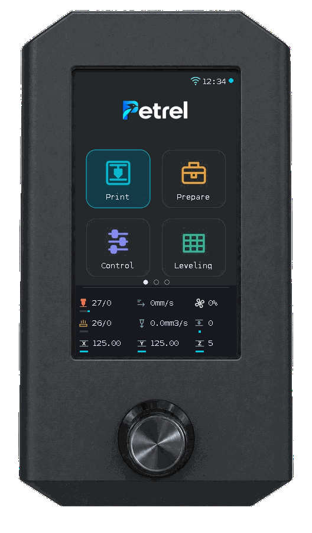

Real UI emulator output with example data.

## Choose and start a print

<p align="center">
  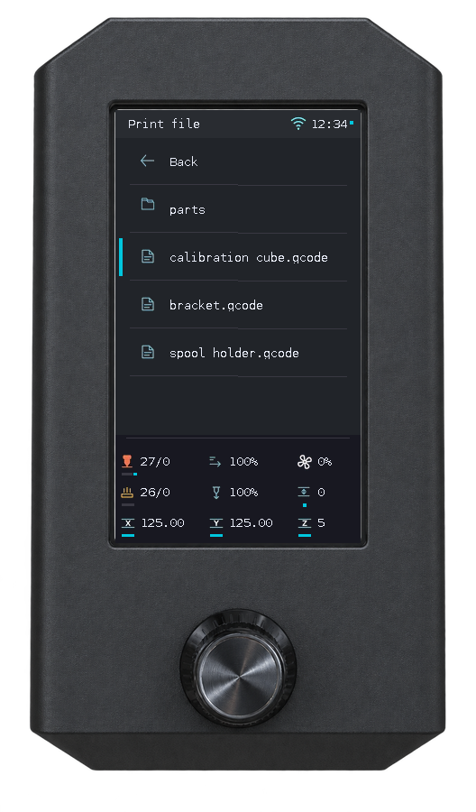
  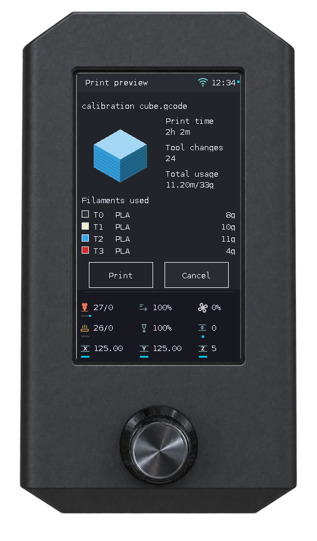
</p>

1. Open **Home → Print**. Select a folder or G-code file. Folders appear first; **Back** goes up one level, or returns Home from the root.
2. Check the model preview, estimated time, tool changes, total filament length/weight and used filament colors/materials/weights when the slicer supplies them.
3. Select **Print** and press to start, or **Cancel** to return to the same file. Cancel is initially selected.

The browser follows Mainsail's name/date/size sorting and direction. Without a valid preference, newest files appear first. Hidden folders and non-G-code files are excluded.

Missing thumbnails or metadata do not prevent printing. Up to four used tools are shown; tool IDs such as T0 are slicer tools, not physical MMU gate numbers. Common previews are prepared ahead of time to make browsing faster.

## Printing and Tune

<p align="center">
  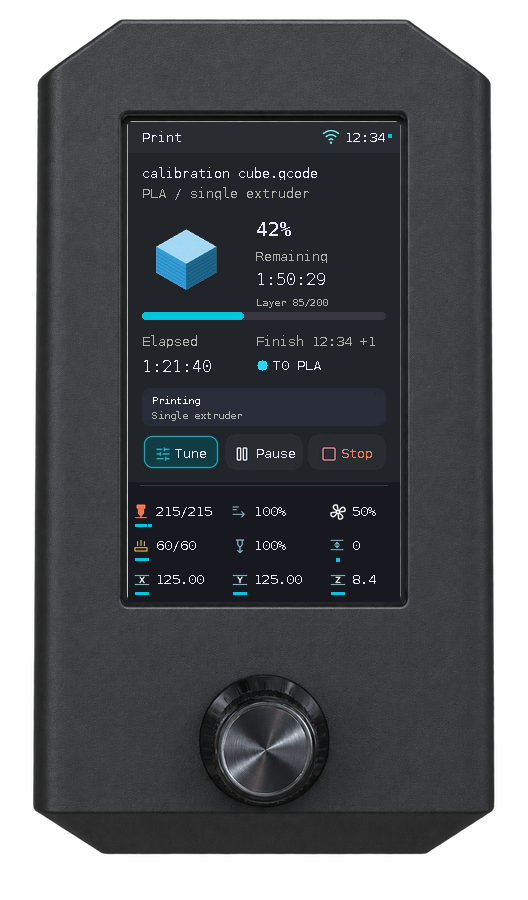
  
  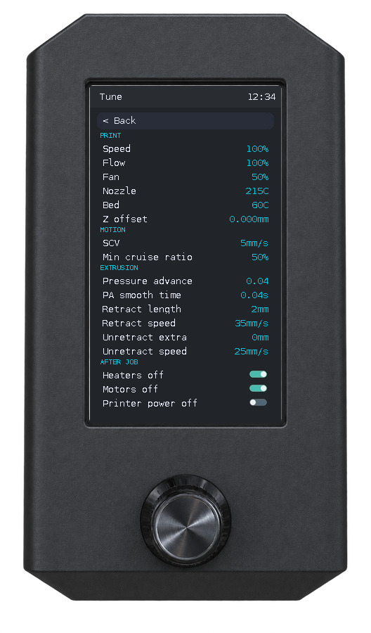
</p>

Print shows the preview, progress, elapsed/remaining time, estimated finish and optional layers. **Pause / Resume** act directly; **Stop** opens confirmation with **Back** initially selected. After confirming Stop, the live Print screen remains visible with an inactive **Stopping** button until cancellation is confirmed by printer state. Do not submit cancellation again while waiting. After completion or cancellation, **Close** returns Home.

Use **Tune** for Speed, **Flow**, temperatures/fan, Z offset, SCV, minimum cruise ratio, PA/smoothing and firmware retraction. Fields depend on configuration and telemetry. AFTER JOB switches only change policy pins; your macros implement the end-of-job actions. Z offset is not permanent probe calibration. See [fields, units and error behavior](print-controls.md).

Elapsed is total job time, including preparation/pauses. Progress, Remaining and Finish use [Mainsail-default calculations](print-controls.md#print-time-and-progress); Remaining averages file/filament estimates, while Finish also includes slicer time. `+1` beside Finish means tomorrow (more generally, the calendar-day offset); missing estimates show `--:--`. Mainsail browser-specific options are not imported.

## Printer connection and recovery

At cold boot or a printer/display relay power cycle, the splash keeps **Connecting to printer...** or **Starting Klipper...** for up to 30 seconds while the connection is pending. An explicit Klipper error/shutdown opens recovery immediately. If connection takes longer, **Printer connection** explains the delay; retries continue without automatic restart. A disconnect after normal startup opens recovery immediately.

The recovery page shows scrollable error text and fixed actions. **Refresh connection** only reads status. **Restart Klipper** and **Firmware Restart** appear for error/shutdown; when Klipper is disconnected, **Restart Klipper service** appears only if Moonraker identifies that instance's exact service. An unreachable Moonraker only offers refresh. Initial focus is Refresh; restart executes on one explicit press after a fresh state check. Turn left past the first action to scroll the error; press to return to the actions. Connection recovery returns Home without resuming an interrupted test or command. See [recovery details](klipper-recovery.md).

## Prepare and Live jog

<p align="center">
  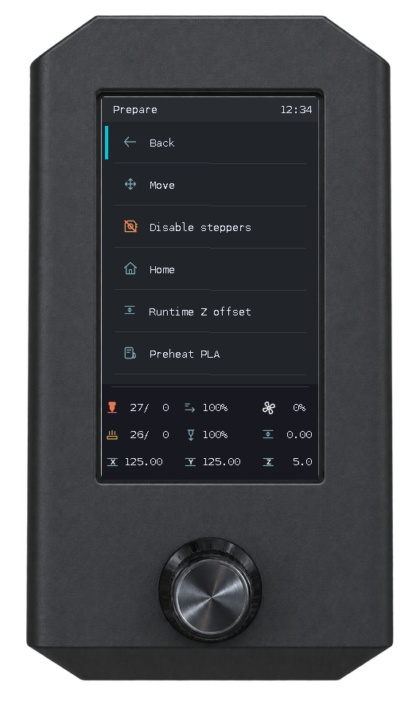
  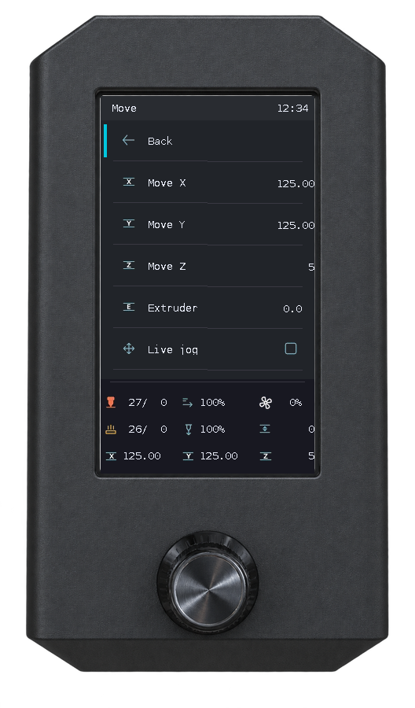
  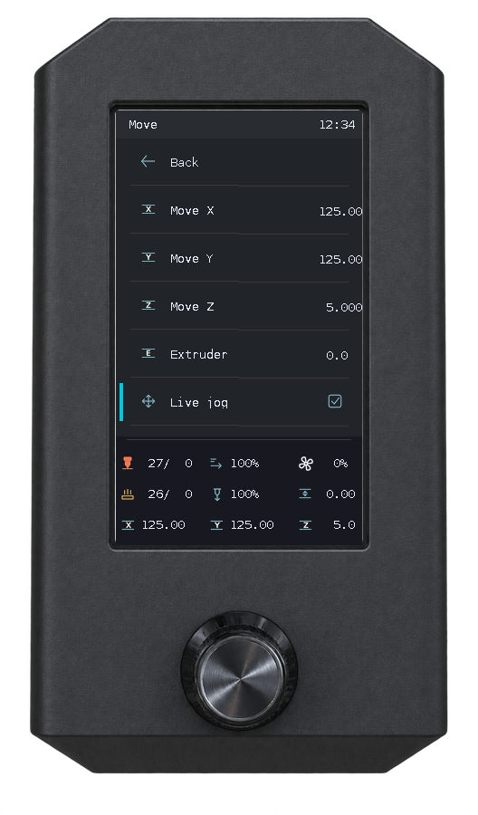
</p>

**Prepare → Home** homes the printer. **Disable steppers** releases the motors. **Runtime Z offset** changes the current session's offset.

In **Prepare → Move**, select X, Y, Z or Extruder, edit the value and press to apply. With **Live jog** checkbox checked, encoder edits move immediately; with the checkbox empty, the movement is applied when confirmed.

Home the required axes first. Movement is unavailable during printing or pauses, and travel limits are enforced. Heat the nozzle before extrusion. If a failed jog leaves movement locked, check the printer and use **Control → Restore jog state** when offered.

## Temperature and preheat presets

<p align="center">
  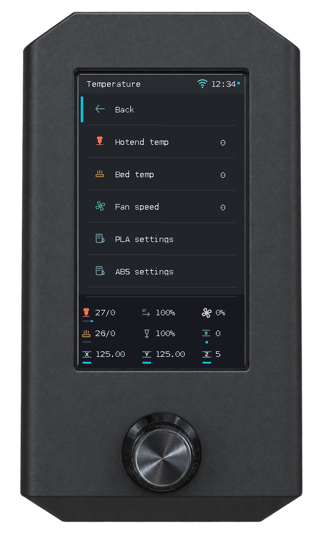
  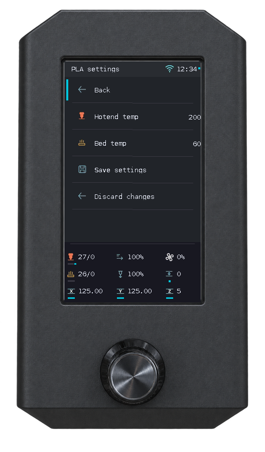
  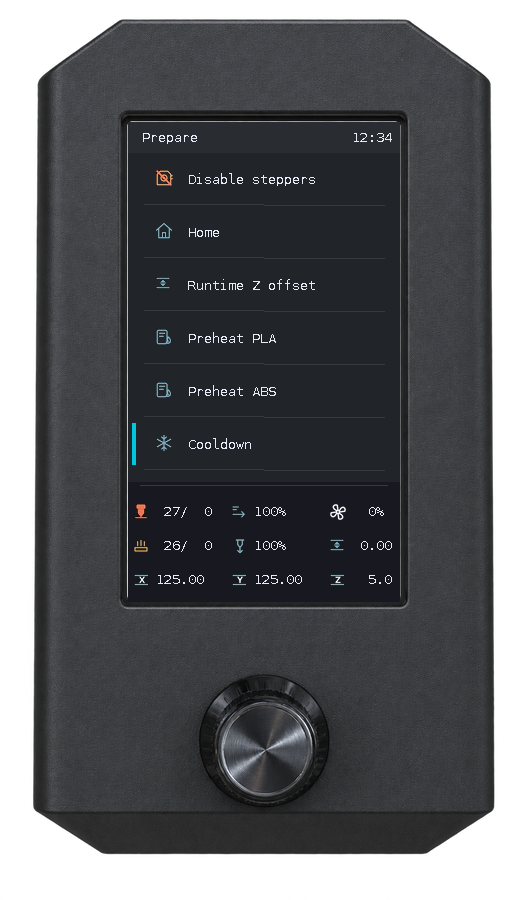
</p>

- **Prepare → Preheat [name]** applies a preset. **Cooldown** turns off the heaters.
- **Control → Temperature** changes available hotend, bed and fan targets.
- Open a preset's **[name] settings**, edit its heater targets and choose **Save settings**. Saving the preset does not start heating. **Back** keeps unsaved edits; **Discard changes** restores the saved values for that preset. Wait for an ongoing save to finish before discarding edits.

Preset names and heater targets are shared with Mainsail when available; LCD edits are saved back there. Without Mainsail presets, local presets are used. Fan settings are not synchronized as temperature presets.

## Runtime motion limits

<p align="center">
  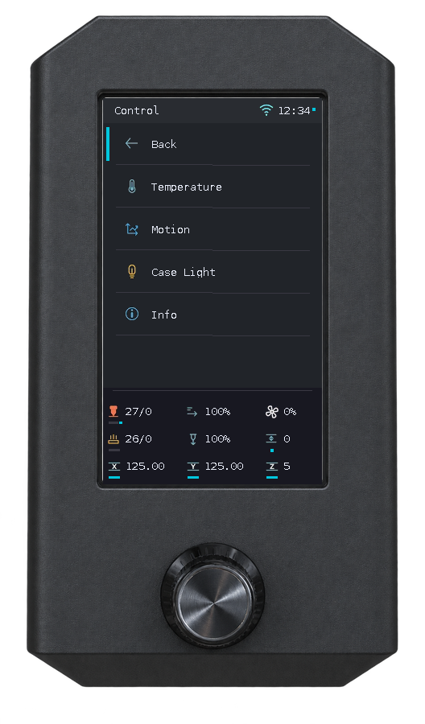
  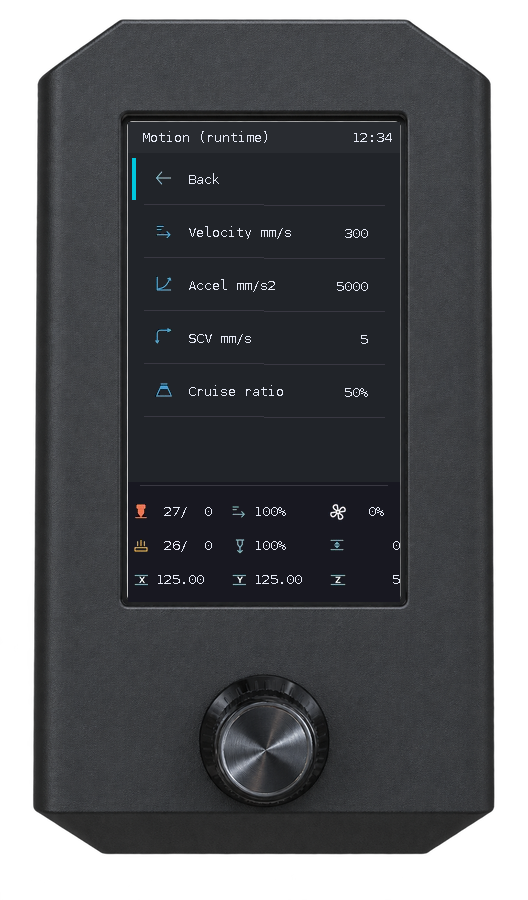
</p>

Open **Control → Motion** to adjust maximum velocity, maximum acceleration, square-corner velocity and minimum cruise ratio when supported. Press a field, rotate and press to apply. Changes are runtime settings; edit your Klipper configuration separately if you want permanent defaults.

## Screw adjustment

Requires a probe and four distinct corner screws in Klipper's `[screws_tilt_adjust]` configuration.

<p align="center">
  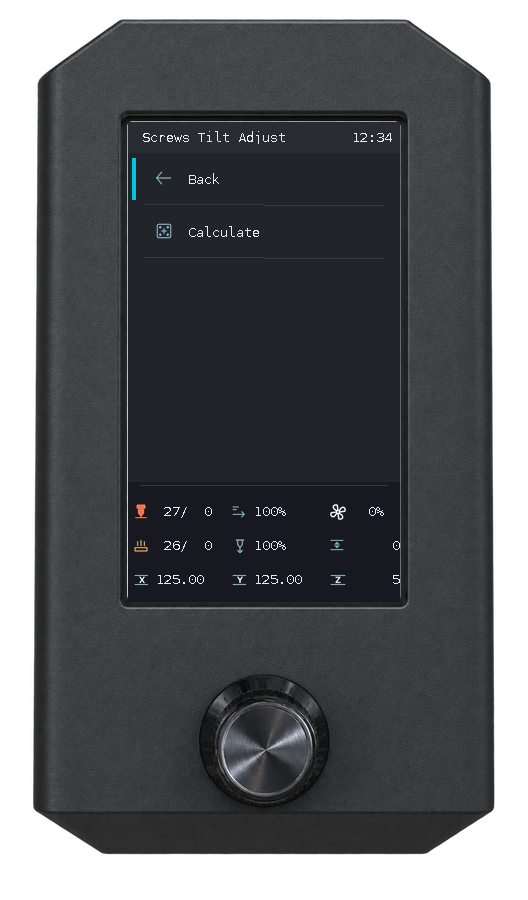
  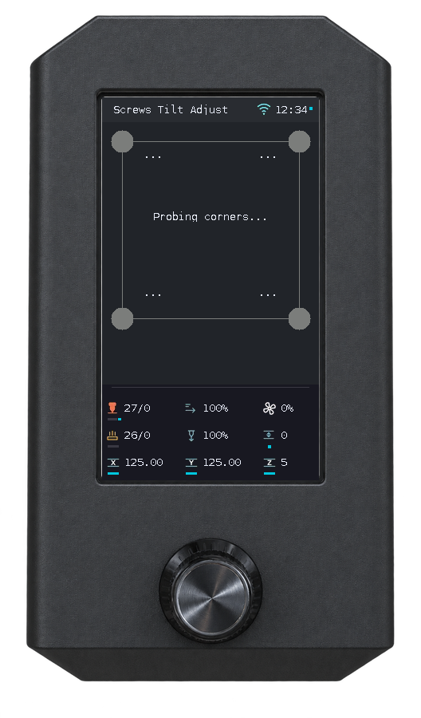
  
  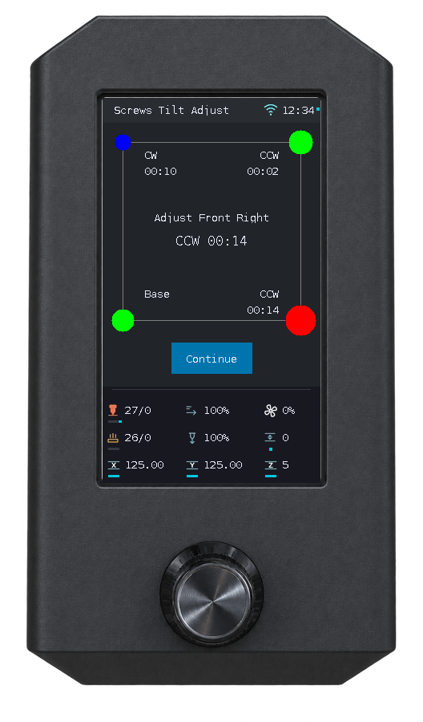
  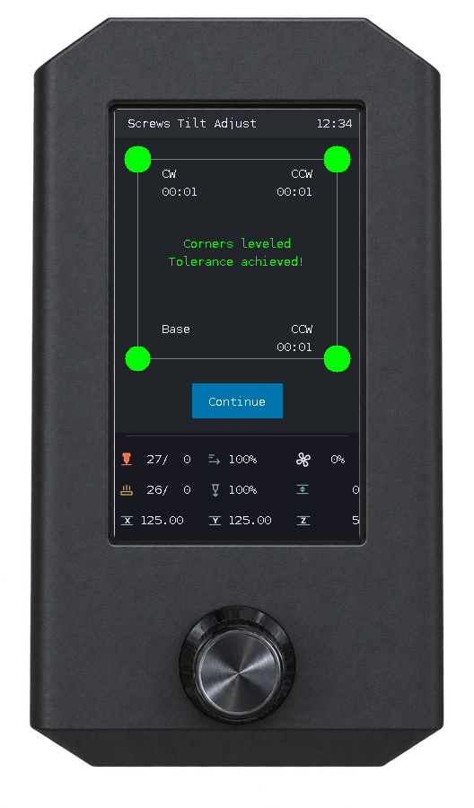
</p>

1. Open **Leveling → Screws Tilt Adjust → Calculate**. Missing axes are homed before measurement.
2. Wait through **Probing corners…** and **Reading results…**.
3. Leave the **Base** screw unchanged. Turn the other screws according to **CW** (clockwise) or **CCW** (counter-clockwise) and the displayed amount. `01:20` means one full turn plus 20/60 of a turn.
4. Choose **Continue**, adjust as needed and calculate again. Green **Corners leveled / Tolerance achieved!** means the measured highest-to-lowest difference is below **0.05 mm**.

The screws are adjusted by you; the screen measures and gives instructions. This workflow does not save configuration.

## Bed mesh and saved profiles

<p align="center">
  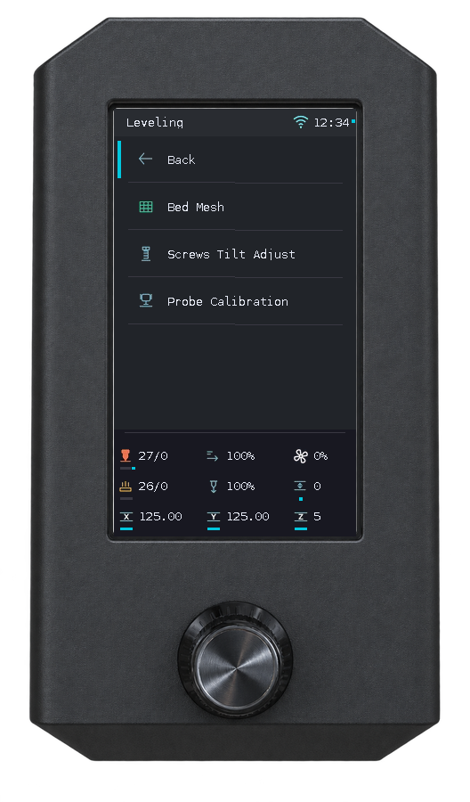
  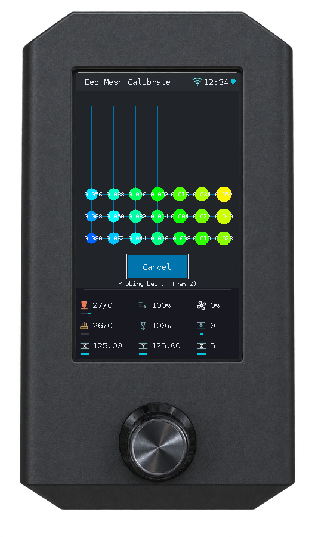
  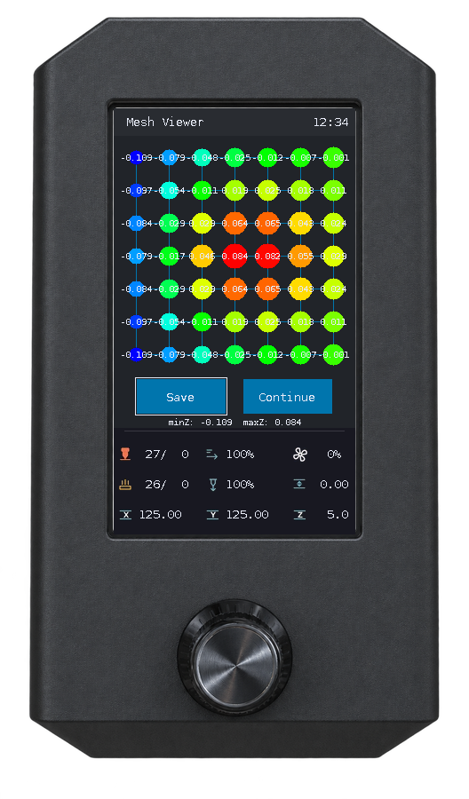
</p>

Open **Home → Leveling → Bed Mesh**. With a configured probe, **Calibrate** homes missing axes and measures the bed. After measurement, inspect the colored height map and minimum/maximum Z values.

During measurement, each probe result appears at its corresponding point. On completion and when opening a saved mesh, colors are scaled to that mesh’s minimum and maximum: lowest is blue, highest is red, with cyan, green and yellow between them.

- **Continue** returns to the menu and keeps the measured mesh for the current session.
- **Save** asks you to confirm the profile and restart. The measured mesh is saved as a generated `lcd_mesh_N` profile; Klipper restarts. Unrelated pending configuration changes can block saving.
- **Mesh Viewer** lets you inspect Current Mesh or saved profiles. Viewing does not load a profile, move the printer or change the active mesh. Low Y is at the bottom of the map.

<p align="center">
  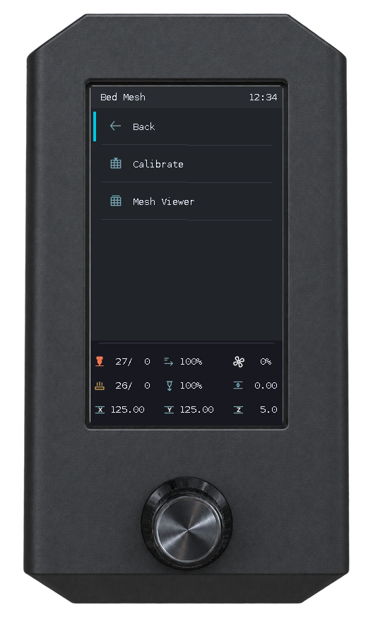
  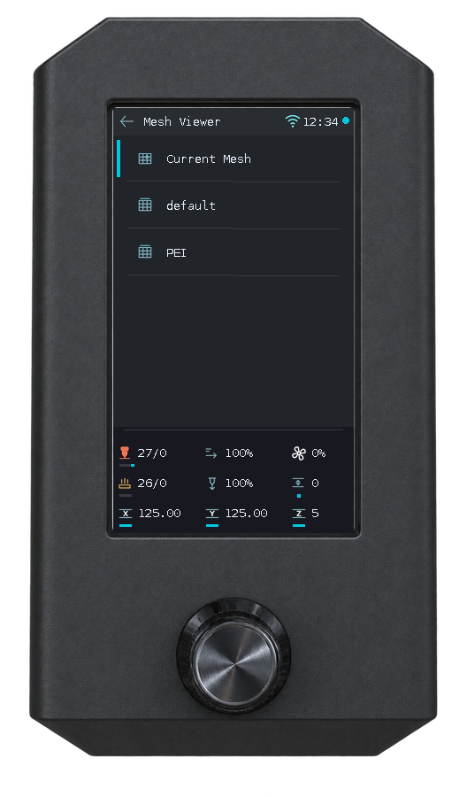
  
  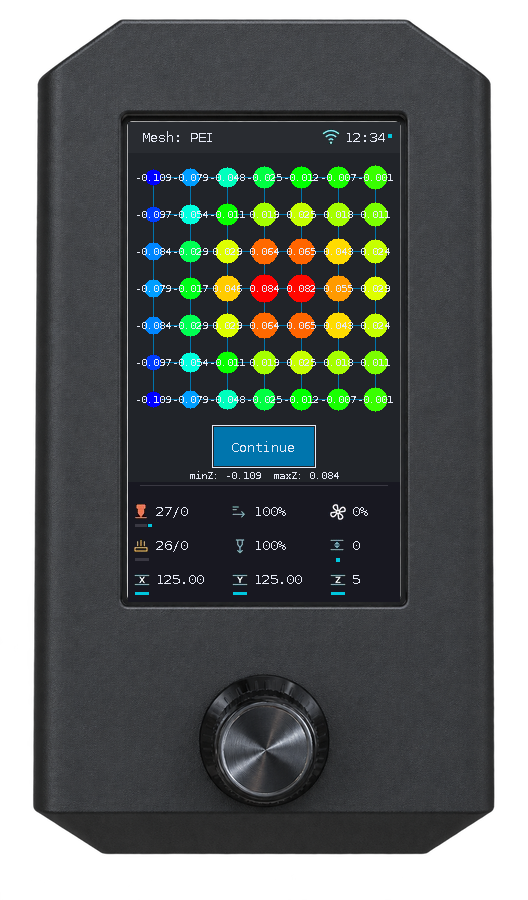
</p>

**Cancel → Stop during measurement is an emergency stop:** Klipper enters shutdown. After checking the printer, use **Firmware Restart** on the recovery screen or `FIRMWARE_RESTART` from the web console. Cancel the confirmation if you want measurement to continue.

## Probe-offset calibration

<p align="center">
  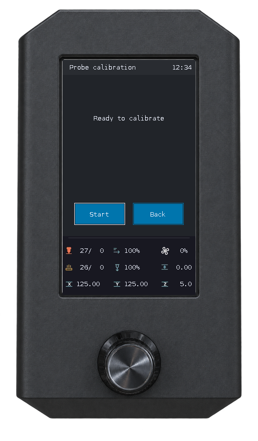
  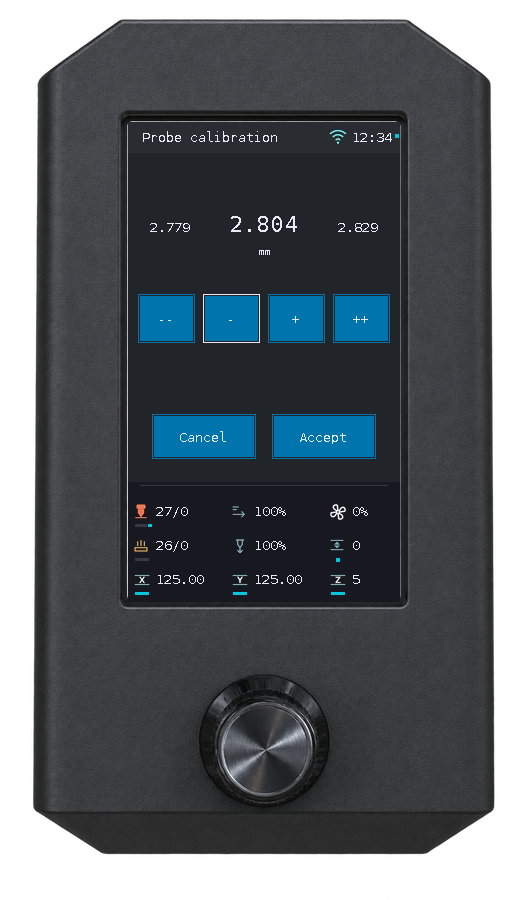
  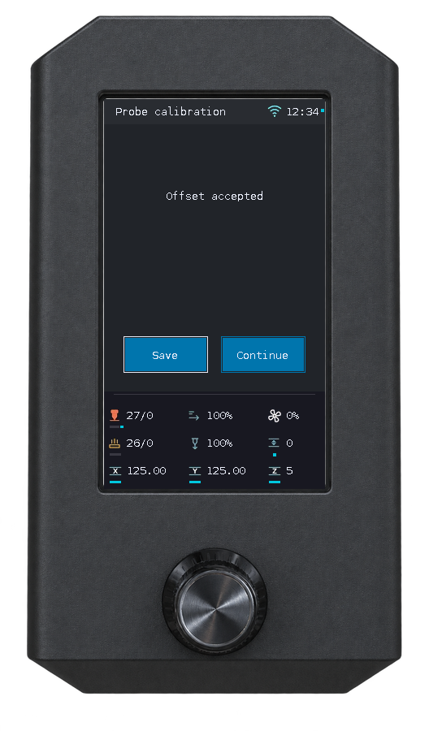
</p>

1. Ensure the bed is clear for calibration. The screen homes XYZ when needed, raises Z for clearance and moves the probe to the configured bed center before probing.
2. Open **Leveling → Probe Calibration → Start**.
3. Watch the live Z height between the lower and upper tested positions. Turn the knob to select one of the four **-- / - / + / ++** buttons and press it to move using Klipper's search steps.
4. Select **Accept** when satisfied, or **Cancel** to cancel the session.
5. After Accept, choose **Save** to persist the offset and restart Klipper, or **Continue** to leave it unsaved.

Printing must be stopped. Pending configuration changes do not block calibration. Saving is allowed only when the pending change is the accepted probe offset. Saving restarts Klipper; this is separate from the temporary runtime Z offset.

## Display settings

The top bar shows the Raspberry Pi's local system time in **HH:MM** format.

<p align="center">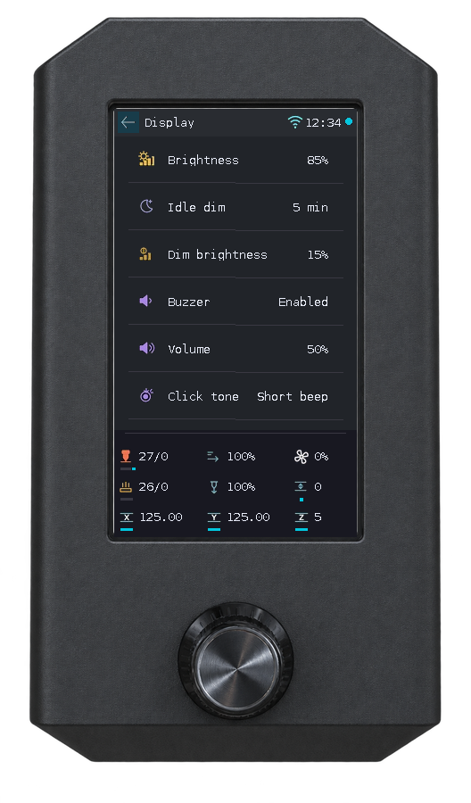</p>

Open **Home → Display**:

| Setting | Use |
|---|---|
| Brightness | Normal brightness, 0–100%; changes are visible while editing |
| Idle dim | Off, or 1–60 minutes without encoder input before dimming |
| Dim brightness | Brightness while dimmed, 0–100%; limited by normal brightness |

Press to edit, rotate and press again to save. Settings survive display power cycles. Defaults are **100%**, **Off** and **10%**. If saving fails, the edit stays open; press to retry.

The first encoder movement or click after idle dimming wakes the display without performing a menu action. **0% turns off the backlight**; while editing Brightness, rotate clockwise to increase it again.

### Buzzer and button sounds

**Display → Buzzer** now switches the buzzer **Enabled/Disabled** directly, with no output selector. **Volume**, **Click tone**, and **Encoder tone** remain editable when off. Press an item, rotate and press again to save. Volume is 0–100% in 10% steps (100% uses 50% physical PWM duty). Tone options are Off, Tick, Short beep, Low, High, Double. Preferences persist in panel Flash.

The buzzer uses Raspberry Pi native **hardware PWM**, without Klipper `pwm_cycle_time`, `output_pin`, or Moonraker G-code. Choose a fixed buzzer GPIO from 12/13/18/19 in `./configure.sh` (**Buzzer hardware PWM**). The installer sets up the device-tree overlay and PWM service access; reboot the Pi when boot options change. NFC card feedback uses the short NFC_TAG_READ melody and respects master Buzzer Enabled/Disabled and Volume. A registered emergency-stop tag instead triggers a ~1.5 s, full-volume two-tone sweep followed by a double high alert using the Raspberry Pi hardware PWM worker. It preempts ordinary feedback, remains audible even after Klipper enters shutdown, and respects the master Buzzer switch and the Emergency card alarm checkbox (not Volume or tone preferences). Clicks never accumulate an unbounded sound queue.

### Named buzzer melodies

All note sequences live in `buzzer_melodies.py`. The library includes
`PRINT_DONE`, `HEATING_DONE`, `COOLING_DONE`, `ERROR`, `FILAMENT_OUT`, `BOOT`,
`SHUTDOWN`, `PAUSE`, `RESUME`, `LAYER_CHANGE`, `HOMING`, `PROBE_SUCCESS`,
`PROBE_FAIL`, `WARNING` and `CUSTOM_EVENT`, using short event-specific motifs with explicit silent rests. Existing UI tones and the
emergency alarm share this library.

Internal UI code can call `self._play_buzzer_melody('PRINT_DONE')`; other code
with the existing player can call `player.play_melody('PRINT_DONE', settings)`.
Reuse the single player instead of starting another PWM owner. Playback is
asynchronous, honors master mute/volume and does not depend on click/encoder
tone selection. Busy playback rejects ordinary requests; `priority=True`
replaces ordinary playback without building a queue. The emergency alarm retains
its dedicated full-volume preemption path and cannot be interrupted by ordinary
melodies. Unknown names raise `ValueError` before queuing.

Sixteen melodies are now wired to application and subscribed printer events:

| Melody | Trigger |
|---|---|
| `PRINT_DONE` | An active print transitions to `complete`; cancellation is silent. |
| `PAUSE` | An active print transitions to `paused`. |
| `RESUME` | `paused` transitions to `printing`; initial start is silent. |
| `ERROR` | A live print enters `error`, or Klipper reports shutdown. |
| `BOOT` | Application startup completes and buzzer preferences are loaded, once per process. |
| `SHUTDOWN` | Confirmed Petrel power-off request, immediately before dispatch. |
| `HEATING_DONE` | Each heater reaches its positive target, using dashboard 2 C entry / 3 C exit hysteresis. |
| `COOLING_DONE` | With target exactly zero, a previously hot heater crosses below 50 C (bed: 40 C). |
| `HOMING` | A Petrel G28 script reaches guarded local dispatch, including calibration preparation. |
| `PROBE_SUCCESS` | Verified mesh/screw-probing results, accepted manual-probe offset, or a passed probe diagnostic. |
| `PROBE_FAIL` | A server-reported probing command error or a failed probe diagnostic. |
| `LAYER_CHANGE` | Reported `print_stats.info.current_layer` increases within the same active print. |
| `FILAMENT_OUT` | Live boolean `mmu.runout` changes from false to true while Happy Hare is enabled. |
| `NFC_TAG_READ` | A card with no Spoolman match (also lookup failure), or emergency/spool enrollment. |
| `NFC_SPOOL_MATCH` | The existing asynchronous Spoolman lookup finds a matched spool. |
| `NFC_SHARE_DONE` | `share.ndef_transferred` closes an active sharing popup; not cancel or failure. |

The NFC family shares a C6/E6 opening: NFC_TAG_READ is a 135 ms two-note
signature, NFC_SPOOL_MATCH adds G6 (290 ms), and NFC_SHARE_DONE resolves through
G6 to C7 (430 ms). Reading waits for the existing asynchronous lookup: a matched spool plays only
NFC_SPOOL_MATCH; no match or a lookup failure plays only NFC_TAG_READ.
Enrollment keeps the generic read cue. Muting the selected cue does not fall back
to the other cue. No new lookup, polling or reader worker
is introduced. All three use global mute/volume; emergency behavior is unchanged.
WARNING and CUSTOM_EVENT remain library-only without automatic bindings.

These use existing WebSocket deltas/lifecycle notifications and UI callbacks,
without additional polling, queries or G-code macros. Initial snapshots,
reconnect snapshots and duplicate states do not replay sounds. Error reports
from print state and Klipper shutdown are deduplicated. Normal connection loss
is not an error melody. Delayed events from a recovered older connection are
discarded. Sound runs asynchronously on the existing bounded PWM worker and
honors Buzzer Enabled/Disabled and Volume. Emergency alarm priority is unchanged.

Heater cycles are independent and share `heater_ready()` with the dashboard.
Reaching target sounds once per target cycle; fluctuations do not rearm it.
Cooling is armed by an observed hot/off state or switching a hot heater off;
a cold initial/reconnect snapshot never announces an old cooling completion.
Targets changed during a cycle replace its tracking. Generic heater temperature
and target use the existing subscription; power telemetry retains its thermal
check/usage lease. Simultaneous identical notifications may coalesce rather than
build an audio backlog.

Homing means local G28 dispatch, not proof of motor movement, and does not cover
opaque homing macros or commands started by other clients. Probe notifications
come from existing operation-result transitions, not new queries or timers.
They announce the whole operation, not every contact. A successful screws-tilt
measurement does not imply the bed is level. User aborts, timeouts, disconnected
sessions and unconfirmed/malformed results do not become probe failures.
Klipper shutdown retains the general ERROR alarm; the special emergency alarm
still has higher priority. Layer sound requires the slicer/macro to report layer information to Klipper.
It never estimates layers from Z motion. The first valid value establishes a
baseline; repeats, decreases, job changes, pause/resume and reconnect snapshots
are silent. A forward jump produces one notification, not catch-up playback.
The Layer changed checkbox controls this cue; global buzzer mute and volume also apply.
Filament runout uses the shared `mmu.runout` contract checked in HH v3.0.1,
v3.4.2, v4.0 and v4.1, rather than parsing version strings. It uses the existing
`mmu` subscription. Missing/nonboolean flags and disabled MMUs are silent. An
initial true value establishes a baseline and is not replayed on reconnect.
Raw sensors, empty gates, pause-reason text and `operation=runout` are not
triggers: the operation name also covers clog/tangle handling. Genuine runout
can sound during EndlessSpool; ordinary load/unload/toolchange alone cannot.
PAUSE sound is suppressed while the semantic runout flag is active. General
ERROR takes precedence in the same notification; emergency priority remains.
Coverage is HH's flagged runout handling, not every sensor error path. The field
is deprecated; if removed in a future version, no raw-sensor inference replaces
it. No extra polling, Klipper extra or macro is installed.

The shutdown sound starts before the power request; shutdown is not delayed
for audio, so cutting power to the Pi may truncate it. Abrupt power loss cannot
produce a reliable shutdown sound. Other melodies remain available by name
without automatic event bindings.

### Event sound switches

Open **Display → Event sounds** for 17 independent checkboxes: the sixteen events above plus **Emergency card alarm**. Rotate to an event and press to toggle it. Every option defaults to enabled on first installation or an upgrade without a valid saved record. WARNING and CUSTOM_EVENT remain library-only.

Each change is saved automatically to DWIN Flash and read back for verification. While saving, the last verified choices remain effective. **Not saved** retains those choices; press again to retry. **Retry read** retries loading preferences. The separate CRC-protected 16-byte record at `0x0480` preserves existing display and buzzer settings.

The master Buzzer switch still mutes all sounds. Ordinary event melodies use Volume. The emergency alarm uses full volume when enabled; disabling its checkbox silences only the alarm and **does not disable the emergency-stop action**. Click and encoder tones keep their existing settings.

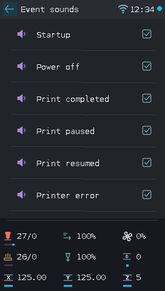
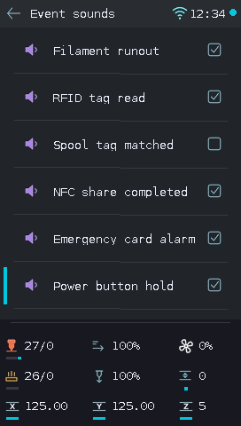

### Klipper virtual buzzer (optional extra)

**Kconfig → Klipper virtual buzzer → Virtual SET_PIN Buzzer Klipper extra** is **enabled by default** for newly applied configurations. Applying it installs the tracked Petrel source as a Klipper extra symlink, registers a managed `petrel-buzzer.cfg` and safely adds its include to `printer.cfg`. Klipper itself is **not restarted**; restart it manually while idle after the configuration change. Disable the Kconfig option to remove only Petrel-managed files while preserving unrelated Klipper configuration.

**Remove your old `[pwm_cycle_time Buzzer]` section yourself before restarting Klipper.** Petrel does not remove it, and two objects registering `PIN=Buzzer` will conflict. The replacement is:

```ini
[petrel_buzzer Buzzer]
socket_path: /home/YOUR_USER/.config/Petrel/klipper-buzzer.sock
value: 0
shutdown_value: 0
cycle_time: 0.001
```

This file is generated by the installer with the actual installation user's absolute path; do not add another copy of it manually. Existing G-code continues to work **without changing commands**:

```gcode
SET_PIN PIN=Buzzer VALUE=0.5 CYCLE_TIME=0.001
G4 P200
SET_PIN PIN=Buzzer VALUE=0
```

The `VALUE` parameter is a **direct electrical PWM duty fraction** (0.0–1.0), optionally divided by `scale` if configured. `CYCLE_TIME` is seconds per PWM cycle (0.00005–1.0 s); omitting it uses the configured default. Unlike Petrel UI's volume scaling, `VALUE=0.5` generates exactly 50% PWM duty. This intentionally does **not** provide backward-compatible Jinja status names.

Klipper's extra transfers events over a **private AF_UNIX datagram socket** to the single Petrel PWM owner, without GPIO access or blocking the G-code queue when Petrel is offline. The master **Display → Buzzer Disabled** mutes Klipper-driven tones as well; UI Volume and tone settings do not rescale the explicit Klipper VALUE. Ordinary LCD tones may temporarily overlay a Klipper tone, and emergency-tag melody takes exclusive priority. On Klipper shutdown the extra sends `shutdown_value`; if that notification is lost, a nonzero external duty has a 30-second safety cutoff. Petrel and Klipper should normally run under the same OS account for private-socket access. The UI remains usable even when Klipper is in shutdown.

### NFC reader settings

Open **Display → NFC settings**. The page reports whether NFC was enabled in
`configure.sh`. When it was not enabled, the NFC rows remain visible but cannot
be selected. Enable NFC in `configure.sh` and restart Petrel to unlock them.
Choose a libnfc reader family, one of that family's available interfaces, an
existing system port/device and the interface speed, then choose **Save**.
Each editable setting opens its own scrollable list: rotate to a choice and
press to select it and return to NFC settings. **Back** leaves the choice list
without changes. The NFC settings rows show each selection right-aligned;
long device names are shortened in the summary but remain identifiable in
the selection list. The **NFC feature** indication is rendered as an Info-style read-only
status (green **Enabled**, muted **Disabled** when off in setup), with the label
aligned to the standard menu column and the value right-aligned, without a menu icon,
action separator or encoder focus.
Rotating through an unavailable NFC setting still advances the scroll
position one row at a time so **Save** and **Test connection** remain visible;
unavailable rows have no selection cursor and cannot be activated. A cursor
returns when navigation reaches the next available action.
Changing the reader or interface clears dependent selections. UART ports come
from Moonraker's `/machine/peripherals/serial` endpoint: exactly one primary
`device_path` per device, rather than extra `/dev/serial/by-id`,
`/dev/serial/by-path` and `/dev/serial0` aliases. The UART list is fetched
asynchronously only when opening **Port / device** and shows a brief
**Loading...** state; an unavailable or empty Moonraker response does not
fall back to a local /dev scan. I2C and SPI continue using existing
Linux device nodes, while USB, PC/SC and NCI use devices actually enumerated
by the installed libnfc build. These interfaces do not have
a separate link-speed control. Settings are stored in the Petrel user's private
configuration directory and the selected connection is applied to the background
reader after saving. Link speed is editable only for UART. I2C, SPI, USB, PC/SC
and NCI show an inactive speed field because libnfc does not apply a configurable
host-interface speed for those transports.

**Test connection** is the final action below **Save** and becomes selectable
once the model, interface and device have been chosen. It tests the *currently
selected* values without saving them. The display shows **Wait** followed
by green **OK** or red **Fail**. The shared libnfc API initializes and opens the
specified reader in initiator mode without needing a tag; it does not establish
card-read quality or RF range. The connection probe is serialized through
Petrel's existing RFID worker, never opens a second handle alongside an active
scan and never blocks the encoder/UI thread. While the probe is pending, saving
is deferred. A completed test does not change the saved settings; failures are
logged for diagnostics.

The list follows libnfc driver families rather than every board vendor's product
name. PN532 offers UART, I2C and SPI in upstream libnfc; the available set still
depends on the installed libnfc build.

## Maintenance

Open **Home → Maintenance** while the printer is idle. Available checks and devices follow the discovered printer configuration. Screen labels remain English.

<p align="center">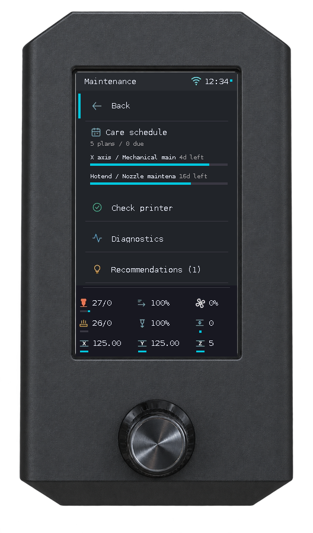</p>

The overview shows the two nearest or due care plans. The four destinations remain in the same place as plans and recommendations grow:

| Destination | Use it for |
|---|---|
| **Care schedule** | All saved reminders, their progress and recording completed maintenance |
| **Check printer** | Guided checks by purpose/device, plus supported calibrations |
| **Diagnostics** | On-demand readings, usage/history and support tools |
| **Recommendations** | Current recorded issues grouped by device and available follow-up checks |

These screenshots show the current UI with example controller records and measurements; they are not new physical test results. Your available entries and readings can differ.

### Care schedule

<p align="center">
  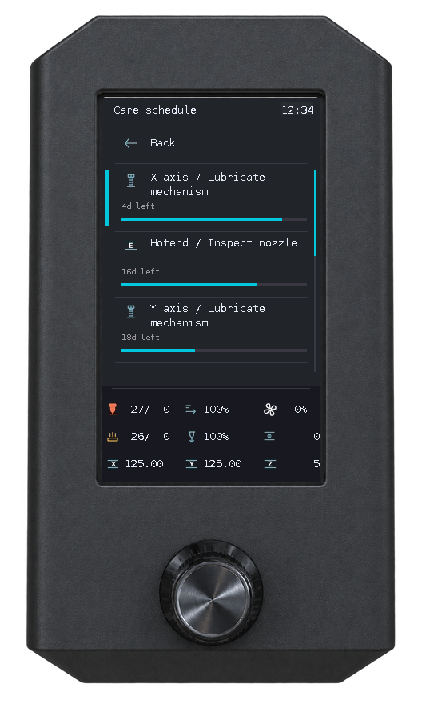
  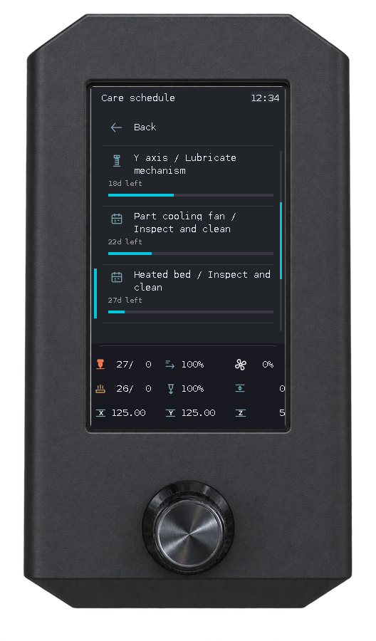
</p>

The bar shows elapsed time within your configured interval, not component wear or remaining life. **Due** means that interval has elapsed. Recorded sampled use since the saved anchor fills the bar; missing/reset readings pause tracking without inventing progress. Rotate to reach every plan; **Back** stays at the top.

1. Open **Care schedule → Add reminder**. Select a supported device, service task and available reminder basis.
2. Set your interval using the manufacturer's maintenance guidance, review it and explicitly save. The starting value is an editable inspection suggestion, not an installed service policy or a manufacturer-certified lifetime.
3. After actually performing maintenance, open its plan and select **I completed this service → Yes, record completion**. This records the service date; it does not award a passed hardware test.
4. Use **Refresh records** to reload saved plans. A load/save error is shown rather than claiming success.

Sampled printing/powered hours cover only the recorded period and are lower bounds. A value below the interval does not prove service is not due.

<p align="center">
  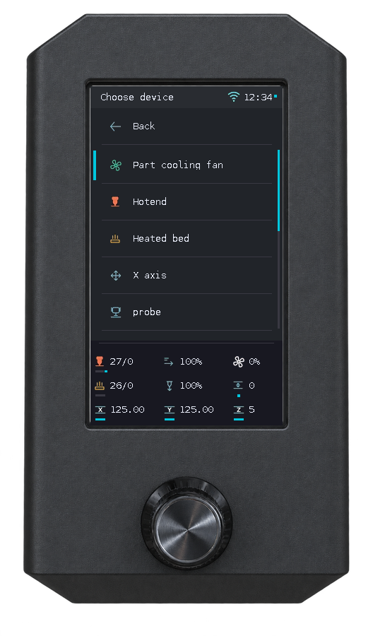
  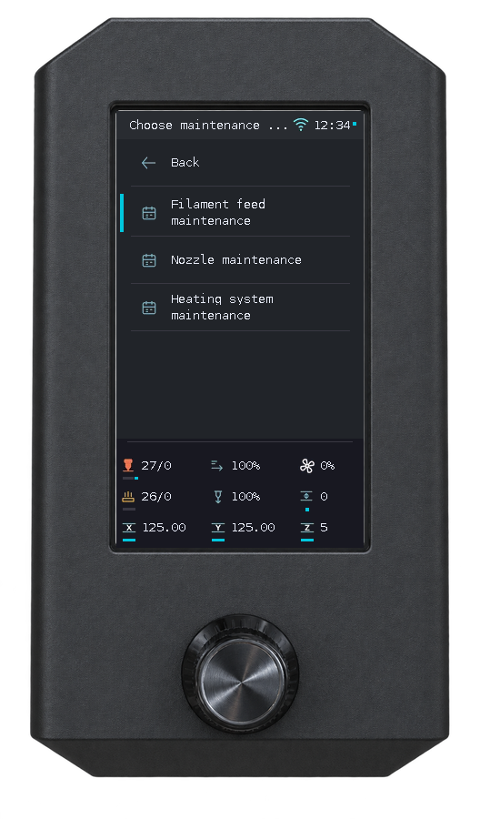
  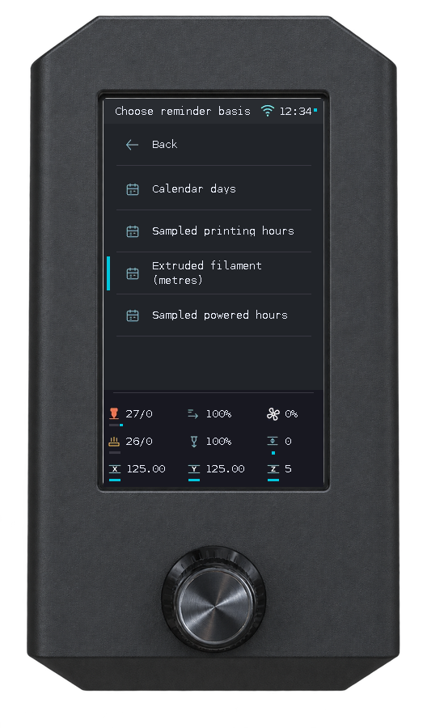
  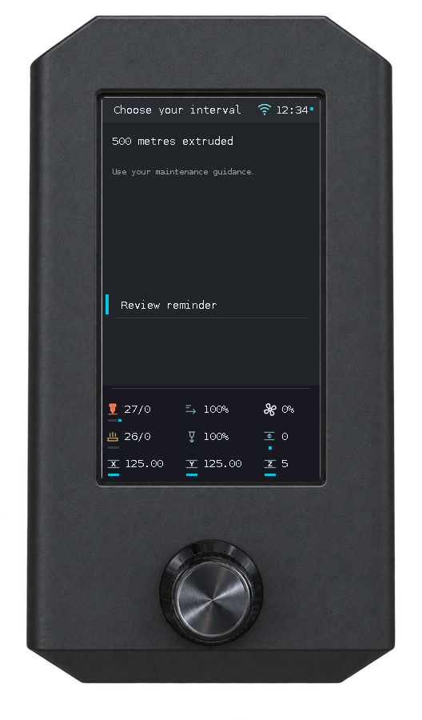
</p>
<p align="center">
  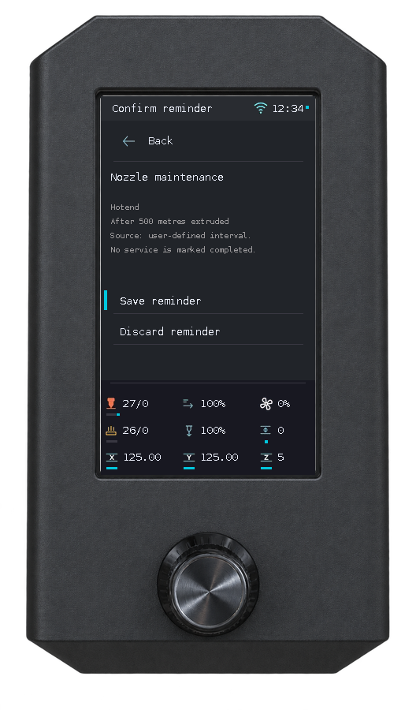
  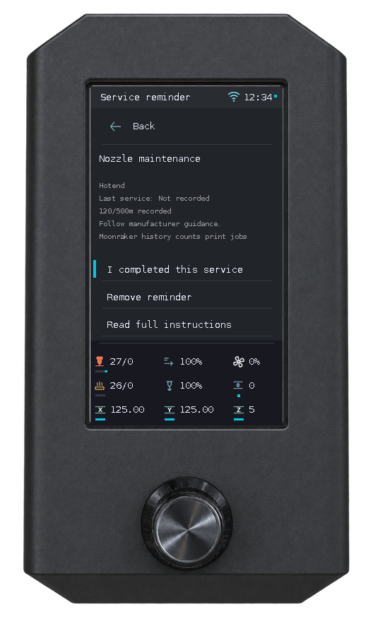
  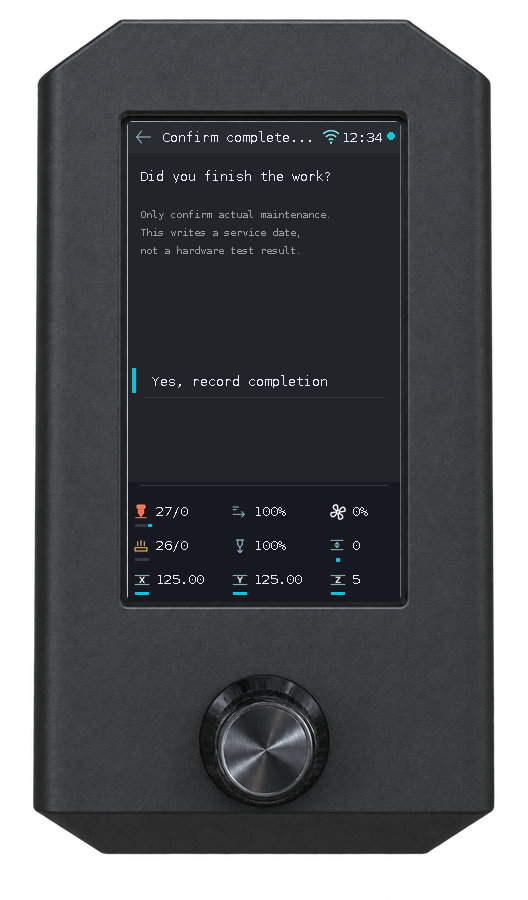
  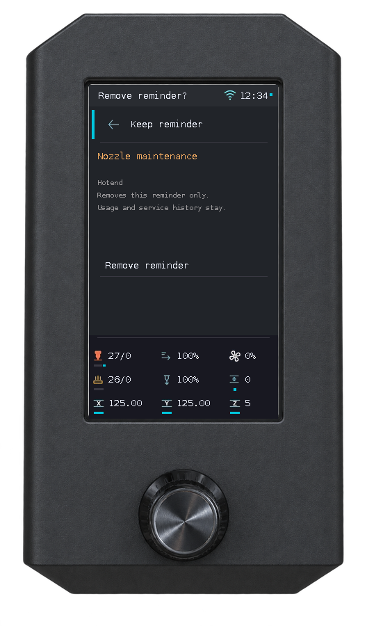
</p>

### Run a check and read its result

<p align="center">
  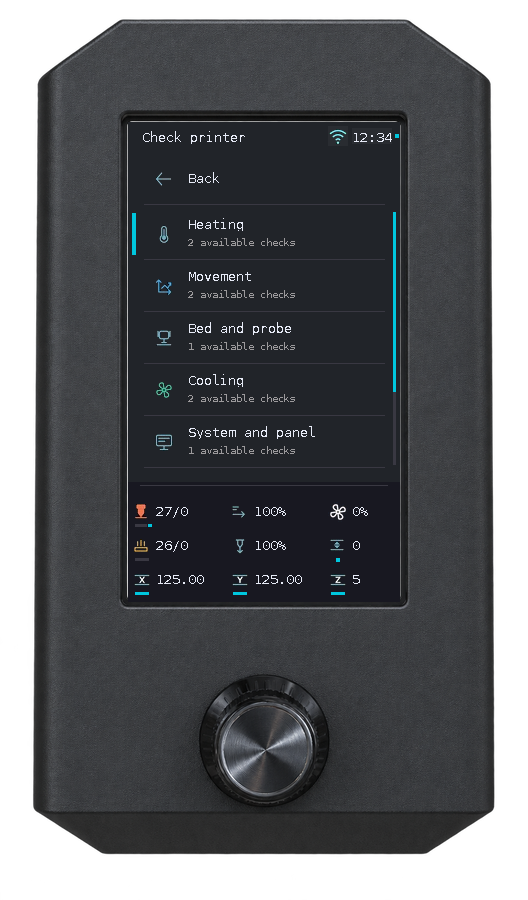
  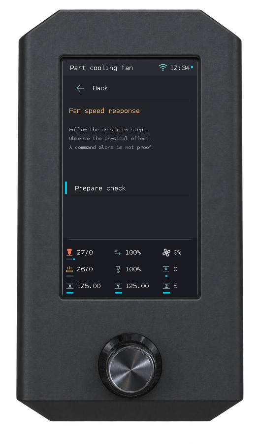
  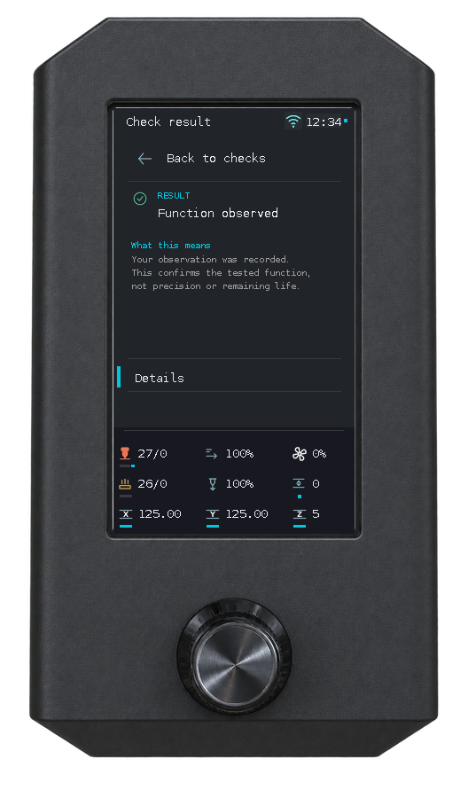
</p>

1. Open **Check printer**, select a group and the check/device you need.
2. Read preparation and choose **Prepare check**. This step does not actuate hardware.
3. Review the separate confirmation and select **Start check**, or **Home axes and continue** when homing is required.
4. Follow the sensor, physical observation or measurement instructions. Enter measured travel rather than commanded travel. A user's answer has no timeout.
5. Read the result heading and **What this means**. Choose **Details** for optional measurements, or **Back to checks** to return to the originating device.

A recorded user observation, a measured criterion and an unfinished check have different meanings. A completed check does not certify every function or remaining component life. Fan startup rounds require explicit confirmation that the fan has physically stopped.

**Stopping active heating requests a Klipper safety shutdown.** Read the stop action before pressing it. Calibration changes are not automatically saved. Everyday probe-offset, screw-adjustment and bed-mesh tools remain under **Leveling**.

### Measurements and diagnostics

<p align="center">
  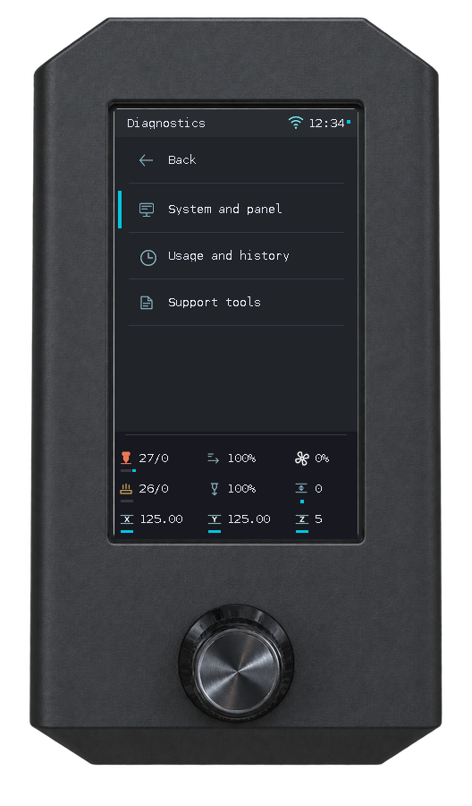
  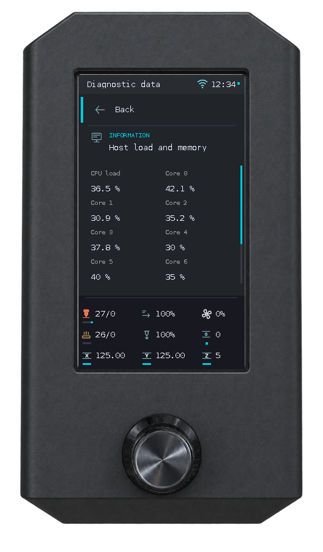
  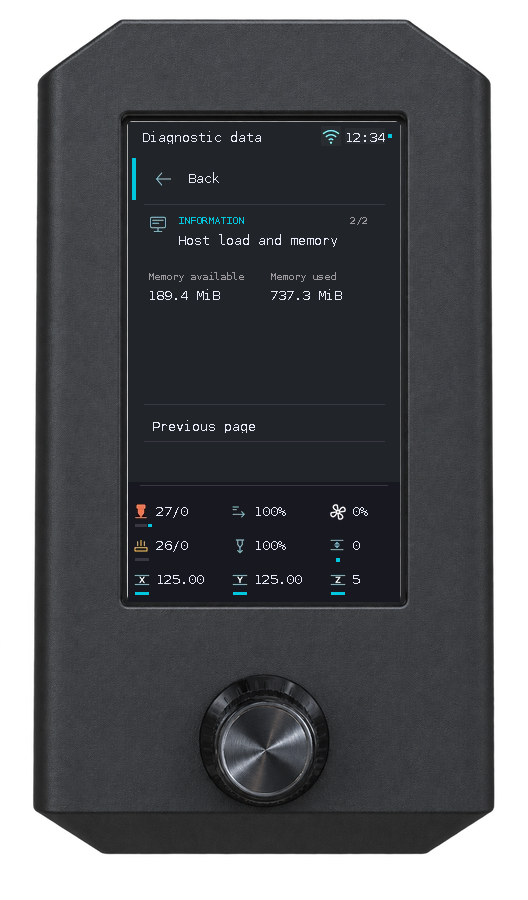
</p>

Open **Diagnostics**, choose a group and select a reading. Information is collected in the background and opens directly as a report. The heading identifies the reading; measurements show their label, value and unit together. Information fields are not selectable menu items.

Rotate the encoder to scroll every Maintenance report vertically; no Next/Previous buttons are needed. The last position wraps to the top, and reverse rotation from the top returns to the end. **Back** and the report heading stay fixed. Pressing while reading returns through Back; real report actions receive focus after the content and require a press. The right scrollbar shows position, and the shared dashboard remains untouched.

<p align="center">
  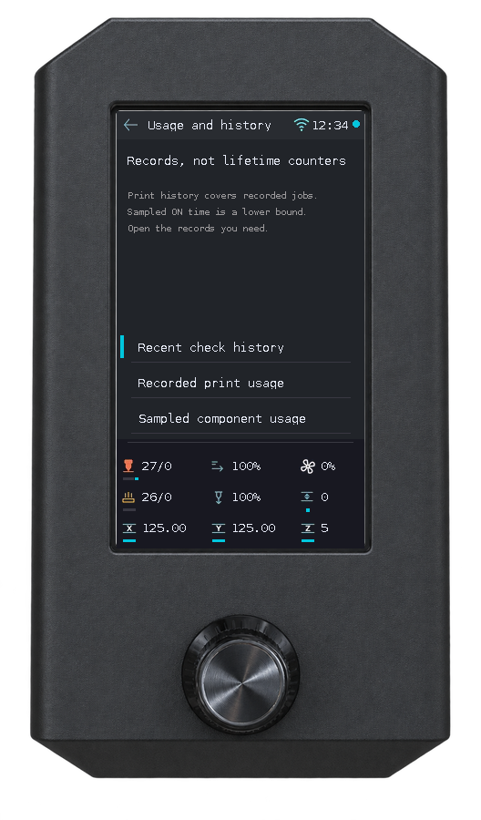
  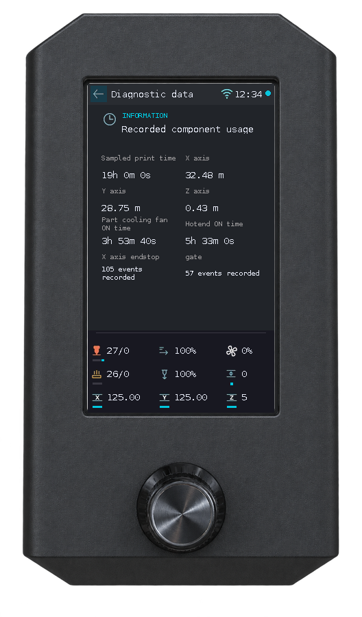
  
  
</p>

To delete a saved reminder, open it in **Care schedule → Remove reminder**, then confirm separately. **Keep reminder** is the default selection. Usage counters and completed-service history are preserved.

Supported fan, heater, output and LED objects automatically offer **Sampled powered hours** based on their own usage. Menu visibility does not control sampling. S12 pages show retained usage quantities without exposing internal tracking/capacity evidence as extra rows; see [Component usage tracking](maintenance-usage.md).

**Diagnostics → Usage and history** contains recorded print usage, sampled component usage and recent check history. Historical evidence is labeled **HISTORY** and does not describe current hardware health. **Support tools** contains optional recording and diagnostic-report export; recording does not start a check.

### Results needing review and recommendations

<p align="center">
  
  
  
</p>

A result needing attention explains what was measured before offering follow-up actions. For example, excessive overshoot asks you to review temperature control; it does not automatically diagnose an aged heater. Supported PID calibration is offered only when registered for that same heater.

**Recommendations** groups current recorded findings by device. Read **What to review**, then choose an offered check if needed. Additional text remains reachable through report pages. No recommendations means no current recorded alert, not that every component is healthy.

A complete heating result may offer **Heating speed reference**. Save only a known-working response after explicit confirmation. Comparison requires equivalent hardware/cooling conditions and your chosen review limit; it is not a manufacturer wear threshold. Remove the reference after hardware changes.

See the [current screen gallery](screenshots.md#maintenance-checks-care-and-diagnostics), [LCD interaction details](maintenance-ui.md), [output profiles](maintenance-profiles.md) and [physical acceptance ledger](maintenance-reference-printer-acceptance.md). Backend acceptance and CI screenshots do not replace physical acceptance of this UI.

## Info and updates

<p align="center">
  
  
  
  
</p>

Open **Home → Info** or **Control → Info**, then rotate to scroll through Machine, Host, MCUs and Software. Check printer dimensions, network/IP, Wi-Fi name/signal, CPU/RAM/temperature, MCU connection/load/temperature and installed software versions. Unavailable values show `N/A` or an unavailable status. MCU temperature needs a configured `temperature_mcu` source; Wi-Fi details require Linux `iw`.

<p align="center">
  
  
  
</p>

Scan the project QR to open the repository. If the connected NFC reader
advertises confirmed Type 4 NDEF URI tag emulation, a compact NFC share icon is shown
immediately before the Petrel version in the Software section. Scroll until its
cyan focus border appears, then press it to open the waiting popup and touch a
compatible phone to the reader to receive the same Petrel repository URL
(`https://github.com/sezgynus/Petrel`). The popup closes automatically only
after the full NDEF URI has been transferred; it does not assert that the
phone opened its browser. Press the encoder to cancel. Unsupported, disconnected
or not-yet-discovered reader capability hides the action entirely. A failed
share is reported in the popup; press to close. This visibility and sharing
logic belongs to a reusable NFC Core-backed UI component, not to each screen.
To update from the LCD:

1. Leave the printer idle and scroll to **Check for updates**. Press the encoder.
2. Wait for **Checking…**. Green **Up to date** means no update is needed; an available update changes the button to **Update**.
3. Select **Update** to install Petrel. Moonraker restarts the service afterwards. This does not update every printer component.

If the checkout is dirty or invalid, **Soft recovery** offers a second **Confirm recovery** step. Recovery discards local repository changes; back up anything you need first. Rotating cancels confirmation. Recovery does not automatically install an update. If a result is unconfirmed, check Mainsail Update Manager before retrying.

Info uses a fixed right-hand position scrollbar. Only exposed content, changed values and the narrow scrollbar gutter are updated during scrolling; unavailable fields are not invented.

## Case light

<p align="center"></p>

**Control → Case Light** appears for a configured `output_pin case_light`. Use On/Off and adjust PWM brightness from 0–100%. On restores the last positive brightness, or 100% when none is known. No macro is needed.

A PWM-capable output can be configured as follows; replace `PA3` with your actual light-control pin:

```ini
[output_pin case_light]
pin: PA3
pwm: True
value: 1.0
shutdown_value: 0
cycle_time: 0.01
```

## Printer power

<p align="center">
  
</p>

Configure the Moonraker power-device name with `./configure.sh`. Hold the encoder button to turn it on; the default hold is **2 seconds**. This works while Klipper or the display is offline, provided the Pi/service and Moonraker remain available.

From any screen, **hold the encoder button for 1.2 seconds, then release** to open power-off confirmation. No hold indicator appears during the first 450 ms; then a small **Hold for power** popup shows the progress. **Cancel is selected initially**; rotate clockwise to select **Power off**, then confirm with a separate short click. Cancel restores the current screen and uncommitted editor value. Shutdown is blocked during printing, paused printing, or an operation in progress. Short clicks act on release without an additional timeout. Releasing an incomplete hold between 450 ms and 1.2 seconds does not select a menu item.

When a relay powers both the printer and display while the Pi stays running, powering back on returns to the first Home page. Wait for startup to finish before using the menus.

When the configured Moonraker power device turns on, Petrel starts nonblocking LCD handshakes at 150 ms intervals. If that device is absent, Klipper becoming ready triggers the same fast connection window. After 10 seconds without a response, handshake requests fall back to 5-second intervals. The connected panel is reused without a fixed 750 ms wake delay.

### Power workflow example


Real UI emulator output with example data. [Original panel PNGs](screenshots.md) and [reproduction](ui-emulator.md#refresh-pngs-frames-and-gifs).

### NFC and RFID (experimental)

**Info → NFC** and **Home → NFC** share one background owner using the public
libnfc C API directly through ctypes. No `nfc-poll`, `nfc-scan-device`, shell or
stdout parser is used. Keep other NFC tools closed. The system libnfc shared
library is required; no compiler or development headers are needed on the Pi.
The reader configuration is selected under **Display → NFC settings**.
The libnfc symbol bindings are cached once in the Petrel process; individual
reader contexts and handles still have explicit session ownership and teardown.
The settings module never performs USB/PCSC/NCI libnfc enumeration: it is queued
exclusively through the NFC Backend worker.
The NFC Backend loads the saved, validated `nfc-settings.json` and opens
**only** its selected device; `PETREL_NFC_DEVICE` and hard-coded UART fallbacks
are not used. With NFC disabled or no valid saved device, no libnfc reader
handle is opened. The backend runs in the existing Petrel process, with one
worker and one device owner across both screens. **Save** signals asynchronous
reconfiguration; it does not close or join the worker on the LCD thread.
Pending Save, connection-test, device-discovery and share requests interrupt an
in-flight libnfc scan; the backend worker closes the old session before using
the reader for another operation. A hardware disconnect clears the current
card/pending arrival and produces a removal event so reconnecting the same card
can generate a fresh detection. Identity is read once per connection and
refreshed after reconnect.
Info shows model, firmware, libnfc version and supported A/B/FeliCa protocols;
PN532 does not expose its module board revision, so Hardware is **Not reported**.
Info and RFID obtain NFC data exclusively from the Core's cached state.
Info NFC fields redraw on `reader.changed` and `capabilities.changed` events,
not on the UI timer. Device discovery, connection probes and saved settings
reload also go through Core. Only the backend owns libnfc handles; UART port
candidates still arrive asynchronously via Moonraker's serial API.

RFID scans all initiator technologies advertised by the reader through libnfc:
ISO14443A/B, B', ST SRx, ASK CTx, FeliCa at both rates, Jewel/Topaz, NFC Barcode,
iClass/PicoPass and passive NFC-DEP when supported. A starts at 106 kbps; higher
Type A communication rates are negotiated after selection. Discovery uses one
activation attempt per turn, with no added sleep, AutoPoll period or card-removal
wait. Type A is initially revisited between other technologies; after a card is
found, its technology receives those extra turns instead. Every other advertised
mode still advances in order. RFID redraws only on NFC Core events; ordinary
printer/status work keeps its 500 ms cadence. The same device handle remains open. A full multi-protocol scan still has
real RF/transport time; no absolute detection latency or simultaneous scan is
promised. Firmware-rejected advertised modes are logged and the status indicates
partial support. Transport failures reconnect with a two-second backoff.

The NFC Backend detects ISO14443A target support and target-mode baud rates
from the connected libnfc device; it advertises `ndef_uri_emulation` as
true/false/unknown through the Core, and Info shows **NFC Sharing**. Unknown,
unsupported and disconnected readers must not expose a URI-sharing action.
Device enumeration for USB/PCSC/NCI is serialized by the NFC Backend worker;
the NFC Settings UI only consumes an asynchronous discovery result.
`share_ndef_uri(url)` temporarily relinquishes initiator scanning, emulates
a read-only NFC Forum Type 4 NDEF URL tag, and emits
`share.ndef_transferred` **only after the full NDEF byte range has been
successfully served**. It does not mean the phone opened a browser. Cancel,
failure and successful transfer relinquish target mode and resume normal
scanning. While sharing, global RFID-card actions are suspended.

### PN532 Type 4 NDEF emulation

Petrel uses the distribution's unmodified `libnfc.so.6` package. PN532
Type 4 target emulation uses upstream `TgInitAsTarget` Mode `0x05`
and fixed ATQA `00 04`; these are not user-selected profiles.

Before each PN532 target activation, Petrel uses libnfc's exported
`pn53x_write_register` helper to request a masked
`CIU_Mode (0x6301)` `ModeDetOff` bit-2 write. The library applies its
write-back cache when sending the next PN532 command. The symbol is
checked when opening a PN532 target session; if the distro libnfc does
not expose it, the target session fails explicitly instead of silently
using a different RF behavior. Other NFC reader types never receive this
PN532-specific register command. No special `.so`, source patch,
compiler, profile selection, or `.enabled` file is required. The
standard NFC installer still controls whether NFC support is installed.

A completed NDEF transfer remains available to the phone for further
Type 4 SELECT/READ commands until an RF inactivity interval of up to
2 seconds; the success event is emitted only once. This allows Android
system URL handling to complete. Physical tests of PN532 + Android with
the distro libnfc found zero FeliCa misclassifications in twenty phone
presentations, although one intermittent target activation `-1` occurred.
The cause of that remaining activation failure has not yet been established.

To remove obsolete locally built experiment libraries and test flags
*after upgrading Petrel* (run as the Petrel service user, without sudo):

```bash
cd ~/Petrel
python3 tools/cleanup_nfc_experiments.py
python3 tools/cleanup_nfc_experiments.py --apply
sudo systemctl restart Petrel.service
```

The cleanup only targets the known experimental PN532 library folders,
temporary build folders and experiment activation/profile files in the
current user's XDG config/data homes. It does not remove the distro
`libnfc6` package, saved NFC hardware settings, or general Petrel data.
The first command is a dry run; both commands refuse to proceed unless
the production system-libnfc driver configuration is available.

The event-driven NFC Core is the single observer of the NFC Backend and
implements scoped, prioritized and consumable `card.detected`/
`card.removed` events. Global emergency-stop mappings preempt ordinary scoped
handlers and dispatch via Moonraker's priority
`printer.emergency_stop` request. User-configurable mappings are saved in
`~/.config/Petrel/nfc-actions.json`; they are not programmable arbitrary
G-code and are **not a substitute for a hardwired emergency stop**.
The existing RFID screen no longer polls at 50 ms or refreshes on a timer:
the Core posts NFC notifications to the existing LCD event queue, and only
the LCD owner draws changed card data. The underlying libnfc initiator still
performs radio scans; there is no PN532 unsolicited UART event mode yet.


The latest card's protocol, complete UID/ID (up to 32 bytes), ATQA and SAK update
live; the identity remains after removal. Each card presentation plays the short
NFC_TAG_READ melody using the global buzzer switch and Volume, independently of
click/encoder tone choices. A held card sounds once; two missed scans of its own technology rearm the same card. IDs are not UUIDs, and ATQA/SAK do not
prove a particular MIFARE chip. Only changed fields are drawn; no card memory is
written or persisted. Scanning continues after leaving the page, and shutdown
aborts pending libnfc I/O before closing the reader. Press to return Home. The
experimental tile reuses the Info icon; screenshots do not yet show these pages.

### Emergency stop tag

Home always ends with **NFC → Info**; add future home entries before Info.
In **NFC**, rotate to **Emergency stop tag** and select **Assign tag** (or
**Replace tag**). Remove any card already held at the reader, then present the
new card. Check the displayed UID and choose **Save tag** to confirm; **Cancel**
leaves the previous assignment intact. **Remove tag** clears the saved mapping.

The single assigned UID is stored atomically in `nfc-actions.json` alongside
the NFC settings and survives Petrel restarts. Presenting that tag sends
Moonraker's `printer.emergency_stop` API request directly from NFC Core,
independently of the visible menu or print state. The existing priority path
does not wait behind ordinary G-code commands. A saved emergency tag retains
priority even during enrollment and cannot be captured as a replacement.
The backend emits one arrival per presentation; remove and retap to trigger
another request. No confirmation dialog delays the emergency action.

The reader must be enabled, configured and listening. NFC target-mode URL
sharing temporarily suspends card detection, as described above. UID matching
is an identification convenience, not authentication or a hardware safety
circuit; it depends on the running Pi, reader and Moonraker connection.

### Assign an NFC tag to a Spoolman spool

Open **Home → NFC → Spoolman tag**. Inventory is loaded on demand in pages of
20 spools; use Previous/Next page for more. List rows show vendor/ID, filament
name, material and a color swatch. Select a spool to see its ID, vendor, name,
material, actual HEX color text and a large swatch; multicolor filament uses
striped swatches. Missing colors are not guessed.

Choose **Assign tag**, remove and present the card, check its UID, then confirm
**Save tag**. NFC Core captures only a fresh arrival and global emergency tags
retain priority. Cancel saves no tag assignment.

The binding is written through Moonraker's Spoolman proxy to the spool's real
**Tags** records: `POST /v1/spool/{id}/tag`. Before showing success, Petrel reads
the spool again and verifies that its `tags` collection contains the UID.
There is no write to `extra.nfc_id` and no silent fallback; servers without the
native Tags API report an explicit error.

If the tag belongs to another spool, **Move and assign** shows source and
target IDs and requires confirmation. Cancel preserves bindings. Approval is
revalidated against current server data; only the requested tag is unlinked
from the source and added to the target. Other target tags are preserved.
Some Moonraker proxies report an error while JSON-decoding the empty 204 unlink
response: Petrel never replays DELETE, but checks the actual source tag list
to verify removal. Partial moves report “Move incomplete”; inspect the
bindings in Spoolman. Failed writes are not automatically replayed.

The previous incorrect release's `extra.nfc_id` values are not automatically
migrated or deleted. Assign the same spool and card again through this flow;
the server's actual **Tags** collection is now checked before reporting success.

This flow does not change the active spool, start MMU loading or write to the
physical tag. Archived spools are omitted from selection but included when
looking up the tag's owner. Spoolman enforces native tag uniqueness; the
two-request move itself is still not an atomic transaction.

### Scan a spool card to assign an MMU gate

Scan a card linked in Spoolman's **Tags** from any normal Petrel screen to open
**Spool #ID: choose gate**. The popup uses the very same library-backed spool icons
as Home and the MMU menu: four muted destination spools and a moving reel colored
from the scanned Spoolman record. The reel's manufacturer, filament name,
material and spool ID move inside a rounded, filament-accented information
card. The remaining percentage is taken from the scanned Spoolman record using
remaining weight and initial weight (or filament weight). If unavailable, a
matching Happy Hare gate percentage is sampled once on opening and rendered with the same
shared SpoolView variable-height fill and percent caption as Home/MMU. The
snapshot remains fixed while the popup is open; a spool with no valid quantity
shows `--` instead of copying another gate's percentage. Gate captions show
the currently assigned spool IDs. The selector has no redundant rotate/press
instructions. Thin connectors join the rounded information card to the moving
reel and the reel to the selected gate; the lower connector retracts as the
reel lands. Native DWIN area moves still carry both sprites without redrawing
the icons on every animation frame. Rotate the encoder to select a gate (groups of
four for larger MMUs), then press to assign. Rotate left to the header Back
control to cancel. During verification the reel remains above the slot; it descends in one
approximately 600ms eased motion only after Happy Hare readback confirms the
assignment. The operation assigns the bound spool ID through Happy Hare; it
does not load filament or start motor movement. Moving
the same spool ID off other gates follows the existing Happy Hare assignment
behavior.

The current Spoolman binding is rechecked after gate selection. Gate count,
MMU state and dispatch-time validation use the existing MMUSession. Printing,
pause/recovery, a busy MMU or an unsupported Spoolman mode blocks assignment;
the prompt shows the reason. Success is displayed after the existing MMU
query/readback path confirms the new gate map. Cancel restores the prior screen
and editor state. Closing an already started assignment does not undo the command.

This uses NFC Core card events, without new libnfc/PN532 access or periodic
Spoolman polling. Lookup work is bounded to one active request plus the latest
arrival; superseded results are discarded. Enrollment retains priority;
emergency tags are dispatched before spool lookup and cancel an open gate
prompt. Unknown or archived spool tags do not open a prompt. Active power/phone
sharing dialogs are not interrupted. Target-mode URI sharing already suspends
card scanning.

### NFC dialogs and completion delivery

Temporary power and gate dialogs preserve an active tag enrollment and its
captured UID. Spoolman catalogue, save, error and move-confirmation results are
stored even while another dialog is visible; returning shows the completed
state without repeating a write. Leaving enrollment for a different screen
cancels it and returns its state to the detail page.

NFC completion wakeups use a separate coalesced mailbox on the existing LCD
owner, bounded to 32 event kinds. A full encoder queue cannot discard these
wakeups; repeated notifications of one kind retain the latest pending state.
No additional NFC/Spoolman polling, hardware handle or worker is introduced.
Only one tag write is admitted at a time. Normal shutdown cancels queued work
and waits up to 60 seconds for an already-started tag write, while retaining its
HTTP client until the read worker stops. If that bound expires, the journal asks
you to check Spoolman Tags. This does not make the remote DELETE/POST move atomic
or guarantee completion after a forced process kill.

NFC examples are generated in CI and published in the
[screenshot gallery](screenshots.md). The existing full documentation render
remains manual. A `docs(nfc):` commit on master opts into the NFC-only publisher
after that exact revision passes regression CI; a newer master is never overwritten.

Emergency tag enrollment captures an already registered emergency card for confirmation without sending an emergency-stop request. Outside that explicit enrollment flow, including spool-tag enrollment, emergency cards retain priority. Canceling enrollment restores normal emergency handling. Remove tag is shown only while an emergency tag is assigned. Both enrollment flows retain NFC_TAG_READ, subject to the master Buzzer switch and Volume.
