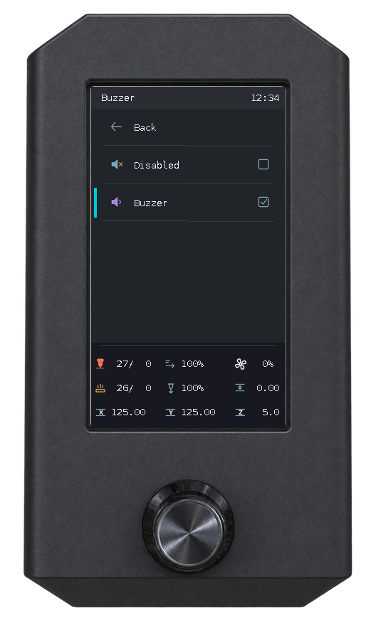
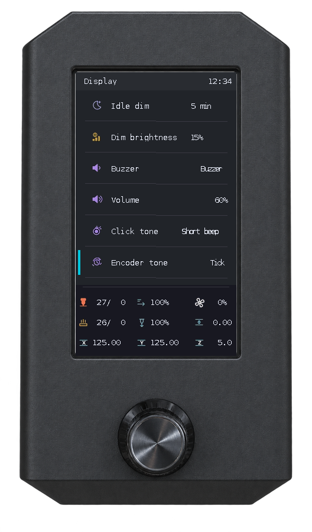
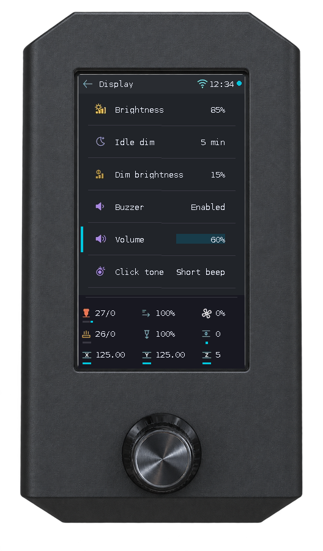

# Daily use

[English](user-guide.md) · [Türkçe](user-guide_TR.md) · [Documentation](README.md)

## Navigation and dashboard

<p align="center">
  
  
</p>

Rotate to move the highlight; press to select. Press a numeric value, rotate to edit it and press again to apply it. **Back** returns to the previous screen. Home shows four icons per page; continue rotating to change pages. Dots indicate the active page. Optional entries depend on your printer's configuration.

The three dashboard rows are shown below. Speed/flow fields alternate every two seconds between an override and instantaneous telemetry. Tune, its numeric editor, the full error reader and MMU pages omit this dashboard.

| Row | Left | Center | Right |
|---|---|---|---|
| 1 | Nozzle actual/target (°C) | Speed override (%) / live velocity (mm/s) | Fan (0–100%) |
| 2 | Bed actual/target (°C) | Flow override (%) / volumetric flow (mm³/s) | Session Z offset (mm) |
| 3 | X (mm) | Y (mm) | Z (mm) |

The other compact markers provide live diagnostics without adding icons: a 12×3 px line beneath the nozzle and a 14×3 px line beneath the bed indicate **heating off** (muted grey), **adjusting toward target** (amber) or **within the target band** (cyan, with hysteresis). A separate 4×3 px dot beneath the nozzle indicates **extrusion allowed** (cyan), **not allowed** (amber) or **unknown** (grey), using Klipper's `can_extrude`. A thin amber line under Speed/Flow appears when the corresponding override differs from 100%; it disappears at 100%, including when the alternating numeric field is showing live telemetry. A tiny cyan dot under Z-offset indicates an **active Bed Mesh** (including an unnamed adaptive mesh); it disappears when no mesh matrix is active. Only changed markers redraw, and all markers read existing subscribed data.

A 14×3 px bar below each X/Y/Z icon indicates Klipper homing status: **cyan** means homed, **amber** means not homed, and **grey** means the reading is unavailable (such as a disconnect). Each bar updates only when that axis status changes; position values and icon spacing are unaffected.

The fan icon uses panel-native animation; its speed follows the fan percentage, rounded to 10 ms intervals. Unchanged intervals send no new command; 0% stops it.

A 4×4 px dot immediately to the **right of the header clock** shows the **Klipper connection**: cyan = ready, amber = connecting, muted red = disconnected/shutdown/error, grey = unknown. This uses the existing Moonraker subscription state, independently of Wi-Fi, and updates only if the state changes. The dot is a native filled rectangle, not an extra icon asset.

A compact Wi-Fi icon beside the header clock shows host RSSI using the same thresholds as Info: **strong** (≥ −60 dBm, three active arcs), **medium** (−70 to below −60 dBm, two arcs) or **poor** (below −70 dBm, one arc). No signal-strength icon is shown when Wi-Fi is disconnected or signal information is unavailable. Ethernet connectivity is independent of this indicator. Its native icon is refreshed only when the band changes.


Real UI emulator output with example data.

## Choose and start a print

<p align="center">
  
  
</p>

1. Open **Home → Print**. Select a folder or G-code file. Folders appear first; **Back** goes up one level, or returns Home from the root.
2. Check the model preview, estimated time, tool changes, total filament length/weight and used filament colors/materials/weights when the slicer supplies them.
3. Select **Print** and press to start, or **Cancel** to return to the same file. Cancel is initially selected.

The browser follows Mainsail's name/date/size sorting and direction. Without a valid preference, newest files appear first. Hidden folders and non-G-code files are excluded.

Missing thumbnails or metadata do not prevent printing. Up to four used tools are shown; tool IDs such as T0 are slicer tools, not physical MMU gate numbers. Common previews are prepared ahead of time to make browsing faster.

## Printing and Tune

<p align="center">
  
  
  
</p>

Print shows the preview, progress, elapsed/remaining time, estimated finish and optional layers. **Pause / Resume** act directly; **Stop** opens confirmation with **Back** initially selected. After confirming Stop, the live Print screen remains visible with an inactive **Stopping** button until cancellation is confirmed by printer state. Do not submit cancellation again while waiting. After completion or cancellation, **Close** returns Home.

Use **Tune** for Speed, **Flow**, temperatures/fan, Z offset, SCV, minimum cruise ratio, PA/smoothing and firmware retraction. Fields depend on configuration and telemetry. AFTER JOB switches only change policy pins; your macros implement the end-of-job actions. Z offset is not permanent probe calibration. See [fields, units and error behavior](print-controls.md).

Elapsed is total job time, including preparation/pauses. Progress, Remaining and Finish use [Mainsail-default calculations](print-controls.md#print-time-and-progress); Remaining averages file/filament estimates, while Finish also includes slicer time. `+1` beside Finish means tomorrow (more generally, the calendar-day offset); missing estimates show `--:--`. Mainsail browser-specific options are not imported.

## Printer connection and recovery

At cold boot or a printer/display relay power cycle, the splash keeps **Connecting to printer...** or **Starting Klipper...** for up to 30 seconds while the connection is pending. An explicit Klipper error/shutdown opens recovery immediately. If connection takes longer, **Printer connection** explains the delay; retries continue without automatic restart. A disconnect after normal startup opens recovery immediately.

The recovery page shows scrollable error text and fixed actions. **Refresh connection** only reads status. **Restart Klipper** and **Firmware Restart** appear for error/shutdown; when Klipper is disconnected, **Restart Klipper service** appears only if Moonraker identifies that instance's exact service. An unreachable Moonraker only offers refresh. Initial focus is Refresh; restart executes on one explicit press after a fresh state check. Turn left past the first action to scroll the error; press to return to the actions. Connection recovery returns Home without resuming an interrupted test or command. See [recovery details](klipper-recovery.md).

## Prepare and Live jog

<p align="center">
  
  
  
</p>

**Prepare → Home** homes the printer. **Disable steppers** releases the motors. **Runtime Z offset** changes the current session's offset.

In **Prepare → Move**, select X, Y, Z or Extruder, edit the value and press to apply. With **Live jog** checkbox checked, encoder edits move immediately; with the checkbox empty, the movement is applied when confirmed.

Home the required axes first. Movement is unavailable during printing or pauses, and travel limits are enforced. Heat the nozzle before extrusion. If a failed jog leaves movement locked, check the printer and use **Control → Restore jog state** when offered.

## Temperature and preheat presets

<p align="center">
  
  
  
</p>

- **Prepare → Preheat [name]** applies a preset. **Cooldown** turns off the heaters.
- **Control → Temperature** changes available hotend, bed and fan targets.
- Open a preset's **[name] settings**, edit its heater targets and choose **Save settings**. Saving the preset does not start heating. **Back** keeps unsaved edits; **Discard changes** restores the saved values for that preset. Wait for an ongoing save to finish before discarding edits.

Preset names and heater targets are shared with Mainsail when available; LCD edits are saved back there. Without Mainsail presets, local presets are used. Fan settings are not synchronized as temperature presets.

## Runtime motion limits

<p align="center">
  
  
</p>

Open **Control → Motion** to adjust maximum velocity, maximum acceleration, square-corner velocity and minimum cruise ratio when supported. Press a field, rotate and press to apply. Changes are runtime settings; edit your Klipper configuration separately if you want permanent defaults.

## Screw adjustment

Requires a probe and four distinct corner screws in Klipper's `[screws_tilt_adjust]` configuration.

<p align="center">
  
  
  
  
  
</p>

1. Open **Leveling → Screws Tilt Adjust → Calculate**. Missing axes are homed before measurement.
2. Wait through **Probing corners…** and **Reading results…**.
3. Leave the **Base** screw unchanged. Turn the other screws according to **CW** (clockwise) or **CCW** (counter-clockwise) and the displayed amount. `01:20` means one full turn plus 20/60 of a turn.
4. Choose **Continue**, adjust as needed and calculate again. Green **Corners leveled / Tolerance achieved!** means the measured highest-to-lowest difference is below **0.05 mm**.

The screws are adjusted by you; the screen measures and gives instructions. This workflow does not save configuration.

## Bed mesh and saved profiles

<p align="center">
  
  
  
</p>

Open **Home → Leveling → Bed Mesh**. With a configured probe, **Calibrate** homes missing axes and measures the bed. After measurement, inspect the colored height map and minimum/maximum Z values.

During measurement, each probe result appears at its corresponding point. On completion and when opening a saved mesh, colors are scaled to that mesh’s minimum and maximum: lowest is blue, highest is red, with cyan, green and yellow between them.

- **Continue** returns to the menu and keeps the measured mesh for the current session.
- **Save** asks you to confirm the profile and restart. The measured mesh is saved as a generated `lcd_mesh_N` profile; Klipper restarts. Unrelated pending configuration changes can block saving.
- **Mesh Viewer** lets you inspect Current Mesh or saved profiles. Viewing does not load a profile, move the printer or change the active mesh. Low Y is at the bottom of the map.

<p align="center">
  
  
  
  
</p>

**Cancel → Stop during measurement is an emergency stop:** Klipper enters shutdown. After checking the printer, use **Firmware Restart** on the recovery screen or `FIRMWARE_RESTART` from the web console. Cancel the confirmation if you want measurement to continue.

## Probe-offset calibration

<p align="center">
  
  
  
</p>

1. Ensure the bed is clear for calibration. The screen homes XYZ when needed, raises Z for clearance and moves the probe to the configured bed center before probing.
2. Open **Leveling → Probe Calibration → Start**.
3. Watch the live Z height between the lower and upper tested positions. Turn the knob to select one of the four **-- / - / + / ++** buttons and press it to move using Klipper's search steps.
4. Select **Accept** when satisfied, or **Cancel** to cancel the session.
5. After Accept, choose **Save** to persist the offset and restart Klipper, or **Continue** to leave it unsaved.

Printing must be stopped. Pending configuration changes do not block calibration. Saving is allowed only when the pending change is the accepted probe offset. Saving restarts Klipper; this is separate from the temporary runtime Z offset.

## Display settings

The top bar shows the Raspberry Pi's local system time in **HH:MM** format.

<p align="center"></p>

Open **Home → Display**:

| Setting | Use |
|---|---|
| Brightness | Normal brightness, 0–100%; changes are visible while editing |
| Idle dim | Off, or 1–60 minutes without encoder input before dimming |
| Dim brightness | Brightness while dimmed, 0–100%; limited by normal brightness |

Press to edit, rotate and press again to save. Settings survive display power cycles. Defaults are **100%**, **Off** and **10%**. If saving fails, the edit stays open; press to retry.

The first encoder movement or click after idle dimming wakes the display without performing a menu action. **0% turns off the backlight**; while editing Brightness, rotate clockwise to increase it again.

### Buzzer and button sounds

<p align="center">
  
  
  
</p>

Open **Display → Buzzer** to choose one of the configured `[pwm_cycle_time name]` outputs, or **Disabled**. Pressing a choice saves it and returns to Display. With an available output selected, **Volume**, **Click tone** and **Encoder tone** appear below Buzzer in Display.

Press an audio setting, rotate to adjust it and press again to save. Volume uses 10% steps from 0 to 100%. Tones include Off, Tick, Short beep, Low, High and Double. Output and sound preferences survive restarts. Sounds play in the background; rapid rotations do not build a sound queue. If the selected section is removed from Klipper configuration, sound controls are hidden until an available output is chosen.

## Maintenance

Open **Home → Maintenance** while the printer is idle. Available checks and devices follow the discovered printer configuration. Screen labels remain English.

<p align="center"></p>

The overview shows the two nearest or due care plans. The four destinations remain in the same place as plans and recommendations grow:

| Destination | Use it for |
|---|---|
| **Care schedule** | All saved reminders, their progress and recording completed maintenance |
| **Check printer** | Guided checks by purpose/device, plus supported calibrations |
| **Diagnostics** | On-demand readings, usage/history and support tools |
| **Recommendations** | Current recorded issues grouped by device and available follow-up checks |

These screenshots show the current UI with example controller records and measurements; they are not new physical test results. Your available entries and readings can differ.

### Care schedule

<p align="center">
  
  
</p>

The bar shows elapsed time within your configured interval, not component wear or remaining life. **Due** means that interval has elapsed. Recorded sampled use since the saved anchor fills the bar; missing/reset readings pause tracking without inventing progress. Rotate to reach every plan; **Back** stays at the top.

1. Open **Care schedule → Add reminder**. Select a supported device, service task and available reminder basis.
2. Set your interval using the manufacturer's maintenance guidance, review it and explicitly save. The starting value is an editable inspection suggestion, not an installed service policy or a manufacturer-certified lifetime.
3. After actually performing maintenance, open its plan and select **I completed this service → Yes, record completion**. This records the service date; it does not award a passed hardware test.
4. Use **Refresh records** to reload saved plans. A load/save error is shown rather than claiming success.

Sampled printing/powered hours cover only the recorded period and are lower bounds. A value below the interval does not prove service is not due.

<p align="center">
  
  
  
  
</p>
<p align="center">
  
  
  
  
</p>

### Run a check and read its result

<p align="center">
  
  
  
</p>

1. Open **Check printer**, select a group and the check/device you need.
2. Read preparation and choose **Prepare check**. This step does not actuate hardware.
3. Review the separate confirmation and select **Start check**, or **Home axes and continue** when homing is required.
4. Follow the sensor, physical observation or measurement instructions. Enter measured travel rather than commanded travel. A user's answer has no timeout.
5. Read the result heading and **What this means**. Choose **Details** for optional measurements, or **Back to checks** to return to the originating device.

A recorded user observation, a measured criterion and an unfinished check have different meanings. A completed check does not certify every function or remaining component life. Fan startup rounds require explicit confirmation that the fan has physically stopped.

**Stopping active heating requests a Klipper safety shutdown.** Read the stop action before pressing it. Calibration changes are not automatically saved. Everyday probe-offset, screw-adjustment and bed-mesh tools remain under **Leveling**.

### Measurements and diagnostics

<p align="center">
  
  
  
</p>

Open **Diagnostics**, choose a group and select a reading. Information is collected in the background and opens directly as a report. The heading identifies the reading; measurements show their label, value and unit together. Information fields are not selectable menu items.

Rotate the encoder to scroll every Maintenance report vertically; no Next/Previous buttons are needed. The last position wraps to the top, and reverse rotation from the top returns to the end. **Back** and the report heading stay fixed. Pressing while reading returns through Back; real report actions receive focus after the content and require a press. The right scrollbar shows position, and the shared dashboard remains untouched.

<p align="center">
  
  
  
  
</p>

To delete a saved reminder, open it in **Care schedule → Remove reminder**, then confirm separately. **Keep reminder** is the default selection. Usage counters and completed-service history are preserved.

Supported fan, heater, output and LED objects automatically offer **Sampled powered hours** based on their own usage. Menu visibility does not control sampling. S12 pages show retained usage quantities without exposing internal tracking/capacity evidence as extra rows; see [Component usage tracking](maintenance-usage.md).

**Diagnostics → Usage and history** contains recorded print usage, sampled component usage and recent check history. Historical evidence is labeled **HISTORY** and does not describe current hardware health. **Support tools** contains optional recording and diagnostic-report export; recording does not start a check.

### Results needing review and recommendations

<p align="center">
  
  
  
</p>

A result needing attention explains what was measured before offering follow-up actions. For example, excessive overshoot asks you to review temperature control; it does not automatically diagnose an aged heater. Supported PID calibration is offered only when registered for that same heater.

**Recommendations** groups current recorded findings by device. Read **What to review**, then choose an offered check if needed. Additional text remains reachable through report pages. No recommendations means no current recorded alert, not that every component is healthy.

A complete heating result may offer **Heating speed reference**. Save only a known-working response after explicit confirmation. Comparison requires equivalent hardware/cooling conditions and your chosen review limit; it is not a manufacturer wear threshold. Remove the reference after hardware changes.

See the [current screen gallery](screenshots.md#maintenance-checks-care-and-diagnostics), [LCD interaction details](maintenance-ui.md), [output profiles](maintenance-profiles.md) and [physical acceptance ledger](maintenance-reference-printer-acceptance.md). Backend acceptance and CI screenshots do not replace physical acceptance of this UI.

## Info and updates

<p align="center">
  
  
  
  
</p>

Open **Home → Info** or **Control → Info**, then rotate to scroll through Machine, Host, MCUs and Software. Check printer dimensions, network/IP, Wi-Fi name/signal, CPU/RAM/temperature, MCU connection/load/temperature and installed software versions. Unavailable values show `N/A` or an unavailable status. MCU temperature needs a configured `temperature_mcu` source; Wi-Fi details require Linux `iw`.

<p align="center">
  
  
  
</p>

Scan the project QR to open the repository. To update from the LCD:

1. Leave the printer idle and scroll to **Check for updates**. Press the encoder.
2. Wait for **Checking…**. Green **Up to date** means no update is needed; an available update changes the button to **Update**.
3. Select **Update** to install Petrel. Moonraker restarts the service afterwards. This does not update every printer component.

If the checkout is dirty or invalid, **Soft recovery** offers a second **Confirm recovery** step. Recovery discards local repository changes; back up anything you need first. Rotating cancels confirmation. Recovery does not automatically install an update. If a result is unconfirmed, check Mainsail Update Manager before retrying.

Info uses a fixed right-hand position scrollbar. Only exposed content, changed values and the narrow scrollbar gutter are updated during scrolling; unavailable fields are not invented.

## Case light

<p align="center"></p>

**Control → Case Light** appears for a configured `output_pin case_light`. Use On/Off and adjust PWM brightness from 0–100%. On restores the last positive brightness, or 100% when none is known. No macro is needed.

A PWM-capable output can be configured as follows; replace `PA3` with your actual light-control pin:

```ini
[output_pin case_light]
pin: PA3
pwm: True
value: 1.0
shutdown_value: 0
cycle_time: 0.01
```

## Printer power

<p align="center">
  
</p>

Configure the Moonraker power-device name with `./configure.sh`. Hold the encoder button to turn it on; the default hold is **2 seconds**. This works while Klipper or the display is offline, provided the Pi/service and Moonraker remain available.

From any screen, **hold the encoder button for 1.2 seconds, then release** to open power-off confirmation. No hold indicator appears during the first 450 ms; then a small **Hold for power** popup shows the progress. **Cancel is selected initially**; rotate clockwise to select **Power off**, then confirm with a separate short click. Cancel restores the current screen and uncommitted editor value. Shutdown is blocked during printing, paused printing, or an operation in progress. Short clicks act on release without an additional timeout. Releasing an incomplete hold between 450 ms and 1.2 seconds does not select a menu item.

When a relay powers both the printer and display while the Pi stays running, powering back on returns to the first Home page. Wait for startup to finish before using the menus.

When the configured Moonraker power device turns on, Petrel starts nonblocking LCD handshakes at 150 ms intervals. If that device is absent, Klipper becoming ready triggers the same fast connection window. After 10 seconds without a response, handshake requests fall back to 5-second intervals. The connected panel is reused without a fixed 750 ms wake delay.

### Power workflow example


Real UI emulator output with example data. [Original panel PNGs](screenshots.md) and [reproduction](ui-emulator.md#refresh-pngs-frames-and-gifs).
